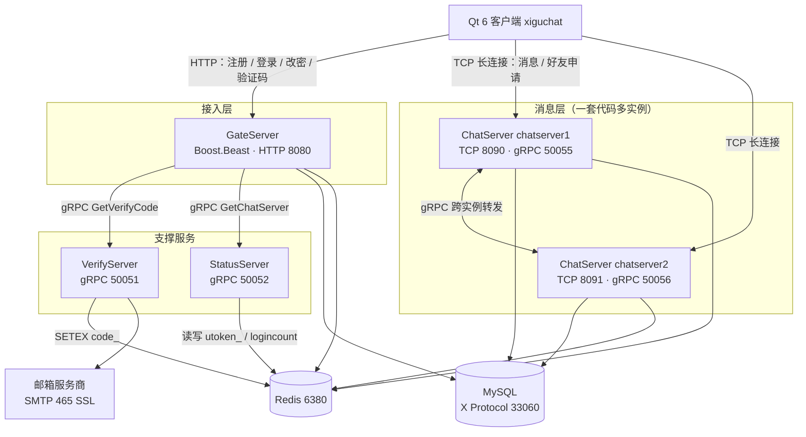

# XiguChat

> 全 C++ 的即时通讯系统：Qt 6 桌面客户端 + gRPC 微服务后端，Windows / macOS / Linux 三平台本地构建运行。

XiguChat 是一个分布式即时通讯系统。客户端用 Qt 6 实现登录注册、好友管理与实时会话；后端拆成四个
独立的 C++ 进程，分别负责 HTTP 网关、状态路由、长连接消息和验证码下发，服务之间用 gRPC 通信，
运行时状态放在 Redis，持久化数据放在 MySQL。

前端与后端均为 C++（客户端 C++17，服务端 C++20），两端各自用 CMake + CMakePresets 驱动，
不含脚本语言或托管运行时。

---

## 目录

- [核心特性](#核心特性)
- [系统架构](#系统架构)
- [目录结构](#目录结构)
- [技术栈](#技术栈)
- [快速开始](#快速开始)
- [端口一览](#端口一览)
- [外部依赖](#外部依赖)
- [文档](#文档)
- [工程约定](#工程约定)
- [已知限制](#已知限制)
- [开源协议](#开源协议)

---

## 核心特性

| 类别 | 说明 |
| --- | --- |
| 全 C++ 技术栈 | 客户端 Qt 6 / C++17，服务端 gRPC / Boost.Asio / C++20，无 Node、无脚本层 |
| 分布式聊天 | ChatServer 一套代码多实例部署，跨实例消息经 gRPC 转发，对客户端透明 |
| 最小连接数调度 | StatusServer 依据 Redis 中各实例的在线连接数分配 ChatServer |
| 双通道通信 | HTTP 短连接处理注册/登录/验证码，TCP 长连接处理实时消息与通知 |
| 连接级会话管理 | 每会话独立 UUID，uid↔session 双向绑定，支持按 uid 定位并推送 |
| 资源池化 | io_context 线程池（= CPU 核心数）、Redis 连接池、gRPC Stub 连接池 |
| 口令安全 | libsodium Argon2id 哈希存储，DAO 层统一加盐哈希 |
| 跨平台构建 | CMakePresets 覆盖三平台 × Debug/Release；后端由 vcpkg manifest 锁定依赖版本 |

---

## 系统架构



四个服务各司其职：

| 服务 | 职责 |
| --- | --- |
| **GateServer** | HTTP 网关。暴露 `/get_verifycode`、`/user_register`、`/reset_pwd`、`/user_login`，向 VerifyServer / StatusServer 发起 RPC，自身不持有长连接 |
| **VerifyServer** | 生成 4 位验证码，写入 Redis（`code_<email>`，TTL 600s），经 SMTP SSL 投递到用户邮箱 |
| **StatusServer** | 登录时签发 UUID token 写入 Redis；按最小连接数挑一个 ChatServer，连 host/port/token 一起返回 |
| **ChatServer** | 维护 TCP 会话、校验 token、处理好友申请与文本消息；本实例直投，跨实例走 gRPC 转发 |

---

## 目录结构

```
xiguchat
├── README.md                   # 项目入口（本文件）
├── LICENSE                     # GPL-3.0
├── backup/                     # 数据库备份（含建表与 reg_user 存储过程，可直接复现库结构）
├── client/                     # 客户端：Qt 6 桌面程序
│   ├── CMakeLists.txt
│   ├── CMakePresets.json       # windows-mingw / macos-clang / linux-gcc × Debug/Release
│   ├── config.ini              # 网关地址
│   ├── main.cpp                # 入口：读取网关地址、加载 QML 根窗口
│   ├── core/                   # 全局定义、单例、用户数据与管理、HTTP/TCP 之上的服务层
│   ├── network/                # HTTP 短连接与 TCP 长连接通信层
│   ├── bridge/                 # QML 与 C++ 的边界：页面桥接对象、列表模型
│   ├── qml/                    # 界面：Main.qml + 各页面 + 组件 + Theme 设计令牌
│   └── resources/              # 图标与 qrc 资源
├── server/                     # 后端：C++ gRPC 微服务
│   ├── CMakeLists.txt
│   ├── CMakePresets.json       # windows-msvc / macos-clang / linux-gcc
│   ├── vcpkg.json              # vcpkg manifest 依赖清单（baseline 锁定）
│   ├── cmake/
│   │   └── XiguChatCommon.cmake# 公共部署规则（config.ini + 运行时 DLL）
│   ├── proto/
│   │   ├── message.proto       # 共享 proto 单一源
│   │   └── CMakeLists.txt      # 构建期生成代码并打包为 xigu_proto 静态库
│   └── services/
│       ├── GateServer/         # HTTP 网关
│       ├── StatusServer/       # 状态路由
│       ├── ChatServer/         # 长连接消息服务（一套代码多实例）
│       │   └── config/         # 每份 *.ini 对应一个运行实例
│       └── VerifyServer/       # 验证码服务
└── docs/                       # 深度技术文档（见下）
```

ChatServer 是"一套代码、配置驱动多实例"：`services/ChatServer/config/` 下每份 `*.ini`
会在构建后生成独立运行目录 `bin/<实例名>/`。新增实例只需再放一份 ini（并登记到
`StatusServer/config.ini` 的 `[chatservers]`），不必改 CMake。

---

## 技术栈

| 层次 | 技术 |
| --- | --- |
| 客户端 | Qt 6.5（Core / Gui / Network / Quick）、C++17、QML + Qt 资源系统（qrc） |
| 服务端 | C++20、gRPC + protobuf、Boost.Asio / Boost.Beast、Boost.PropertyTree、Boost.Uuid |
| 存储 | MySQL 8（X DevAPI / X Protocol 33060）、Redis（hiredis） |
| 安全 | libsodium（Argon2id 口令哈希）、Poco NetSSL（SMTP over SSL） |
| 构建 | CMake ≥ 3.21、Ninja / Visual Studio、vcpkg（manifest 模式） |

---

## 快速开始

### 1. 准备外部服务

```bash
# MySQL：暴露 3306（经典协议）与 33060（X 协议，后端实际使用）
docker run -d --name chat-mysql -p 3306:3306 -p 33060:33060 \
  -e MYSQL_ROOT_PASSWORD=123456 mysql:8

# Redis：项目配置使用 6380 端口，密码 123456
docker run -d --name chat-redis -p 6380:6379 -v redis-data:/data \
  redis:latest redis-server --requirepass 123456
```

创建 schema `xigu` 后直接导入仓库自带的 `backup/xigu.sql`，即可一次性得到
全部表结构、`reg_user` 存储过程与初始数据，无需手工建表：

```bash
docker exec -i chat-mysql mysql -uroot -p123456 -e "CREATE DATABASE IF NOT EXISTS xigu
  DEFAULT CHARACTER SET utf8mb4 COLLATE utf8mb4_unicode_ci;"
docker exec -i chat-mysql mysql -uroot -p123456 xigu < backup/xigu.sql
```

### 2. 构建后端

```bash
cd server
export VCPKG_ROOT=/path/to/vcpkg          # Windows: set VCPKG_ROOT=D:\vcpkg

cmake --preset macos-clang                # 或 windows-msvc / linux-gcc
cmake --build --preset macos-clang
```

macOS / Linux 上 `libsodium` 走 autotools 构建，需系统预装
`autoconf autoconf-archive automake libtool`（详见 `docs/02-build.md`）；Windows 不需要。

### 3. 构建客户端

```bash
cd client
cmake --preset macos-clang                # 或 windows-mingw / linux-gcc
cmake --build --preset macos-clang
```

命令行构建时可用 `QT_ROOT` 指定 Qt 安装；Windows MinGW 还需 `QT_MINGW_ROOT`
（必须为 Qt 6.5 配套的 `mingw1120_64`）。Qt Creator 用户直接打开 `client/CMakeLists.txt` 选 Kit 即可。

### 4. 启动

每个服务都按当前工作目录读取 `config.ini`，所以必须进入各自目录启动：

```bash
cd build/macos-clang/bin

(cd VerifyServer && ./VerifyServer)
(cd StatusServer && ./StatusServer)
(cd ChatServer && ./ChatServer)   # 实例 chatserver1
(cd ChatServer2 && ./ChatServer)  # 实例 chatserver2
(cd GateServer && ./GateServer)
```

上述服务分别在独立终端启动；Windows 多配置构建需再进入 Debug/Release 子目录。

启动顺序建议：VerifyServer → StatusServer → ChatServer（各实例）→ GateServer。

### 5. 配置邮件（可选但推荐）

编辑 `bin/VerifyServer/config.ini` 的 `[Email]` 段，填入 SMTP 账号与授权码。
`CA` 留空时按平台自动探测系统 CA bundle，证书校验失败会直接导致发信失败。
完整配置项见 `docs/05-configuration.md`。

---

## 端口一览

| 服务 / 组件 | 协议 | 端口 | 说明 |
| --- | --- | --- | --- |
| GateServer | HTTP | 8080 | 客户端 HTTP 接口 |
| VerifyServer | gRPC | 50051 | 验证码下发 |
| StatusServer | gRPC | 50052 | 状态路由 / 令牌校验 |
| ChatServer `chatserver1` | TCP + gRPC | 8090 / 50055 | TCP 面向客户端，gRPC 面向服务间 |
| ChatServer `chatserver2` | TCP + gRPC | 8091 / 50056 | 同上 |
| MySQL | 经典 / X 协议 | 3306 / 33060 | 后端使用 **X 协议 33060** |
| Redis | RESP | 6380 | 密码 123456 |

---

## 外部依赖

| 依赖 | 地址 | 用途 |
| --- | --- | --- |
| MySQL | `127.0.0.1:33060`（X 协议） | 用户、好友、好友申请持久化；schema `xigu` |
| Redis | `127.0.0.1:6380` | token、用户缓存、实例位置、连接计数、验证码 |

---

## 文档

深度技术文档位于 [`docs/`](docs/README.md)：

| 文档 | 内容 |
| --- | --- |
| [docs/README.md](docs/README.md) | 文档索引与阅读路径 |
| [01-架构设计](docs/01-architecture.md) | 分层、线程模型、三条核心流程时序、消息路由 |
| [02-构建与部署](docs/02-build.md) | CMake 预设、vcpkg、多实例机制、产物布局、跨平台差异 |
| [03-通信协议](docs/03-protocol.md) | TCP 私有协议、HTTP 接口、gRPC 接口、错误码总表 |
| [04-数据模型](docs/04-data-model.md) | MySQL 表结构与存储过程、Redis 键空间设计 |
| [05-配置参考](docs/05-configuration.md) | 全部 `config.ini` 段落与字段说明 |
| [06-客户端](docs/06-client.md) | Qt 客户端模块划分、通信层、UI 层、资源与样式 |
| [07-GateServer](docs/07-gate-server.md) | HTTP 网关实现细节 |
| [08-StatusServer](docs/08-status-server.md) | 状态路由与令牌服务 |
| [09-ChatServer](docs/09-chat-server.md) | 长连接服务、会话管理、跨实例转发 |
| [10-VerifyServer](docs/10-verify-server.md) | 验证码服务与 SMTP 发信 |
| [11-已知限制](docs/11-known-limitations.md) | 技术债与改进方向 |

---

## 工程约定

- **编码**：全部源码 UTF-8 无 BOM，中文注释按 UTF-8 保存。
- **标准**：服务端 C++20，客户端 C++17；禁用编译器扩展（`CMAKE_CXX_EXTENSIONS OFF`）。
- **跨平台**：涉及平台差异时（`WIN32` / `APPLE` / `UNIX`、单配置与多配置生成器）
  必须同时保证三平台行为正确，注释中注明各自行为。
- **协议同步**：消息 ID 在服务端 `include/const.h` 的 `MSG_IDS` 与客户端 `core/global.h`
  的 `ReqId` 中各有一份定义，**修改协议必须同步两端**。
- **配置读取**：所有服务按当前工作目录读取 `config.ini`，启动时须 `cd` 到自身目录。

---

## 已知限制

本项目定位为学习与工程实践项目，以下为已知的功能与安全缺口（完整清单见
[docs/11-known-limitations.md](docs/11-known-limitations.md)）：

- 密码在 HTTP 链路上为可逆 XOR 变形，非加密传输；网关未启用 TLS。
- Token 无有效期、无刷新与吊销机制。
- 已有客户端心跳与服务端超时扫描；尚无断线重连、离线消息存储与送达确认。
- `StatusServer::Login` RPC 已实现但尚未被 ChatServer 调用（后者直接读 Redis 校验 token）。

---

## 开源协议

本项目采用 **GNU General Public License v3.0**，详见 [LICENSE](LICENSE)。
