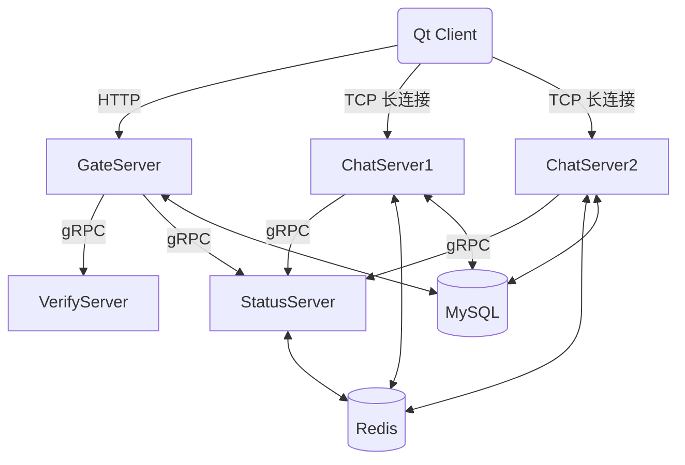

# XiguChat

XiguChat 是一个基于 **C++/Qt** 的分布式即时通讯（IM）系统，包含桌面客户端与多服务端后端。系统覆盖注册/登录、好友管理、单聊消息等核心业务，并支持多 ChatServer 横向扩展。

## ✨ 功能概览

**客户端（Qt/C++）**

- 跨平台桌面端（Qt Widgets）
- 自定义聊天 UI 组件（气泡、列表、富文本输入等）
- 账号注册/登录、好友搜索与添加、好友列表、实时消息收发
- HTTP（登录注册） + TCP（消息）双通道通信

**服务端（C++/gRPC）**

- **GateServer**：HTTP 入口，注册/登录与 ChatServer 分配
- **ChatServer**：TCP 长连接消息处理与路由转发，支持多实例扩展
- **StatusServer**：用户在线状态与路由信息聚合

**验证服务（Node.js/gRPC）**

- **VerifyServer**：验证码生成、邮件发送、Redis 缓存

## 🧭 架构概览



## 🧰 技术栈

- **语言**：C++17、JavaScript (Node.js)
- **GUI**：Qt Widgets
- **网络**：Boost.Asio、gRPC、Protocol Buffers
- **存储**：MySQL（用户/关系/离线消息等）
- **缓存**：Redis（验证码、状态、路由信息）

## 📁 目录结构

```
.
├─ client/                # Qt 客户端工程
├─ server/
│  ├─ GateServer/         # HTTP 网关服务
│  ├─ ChatServer/         # 聊天服务
│  ├─ ChatServer2/        # 第二个聊天服务实例
│  ├─ StatusServer/       # 状态服务
│  └─ VerifyServer/       # Node.js 验证码服务
└─ backup/xigu.sql        # 数据库初始化脚本
```

## 🚀 快速开始

### 1. 依赖准备

- **C++ 构建**：Visual Studio (MSBuild) 或支持 C++17 的编译环境
- **Qt**：Qt 5.x（Widgets）
- **三方库**：Boost、gRPC & Protobuf、MySQL C++ Connector / C API、Hiredis
- **运行环境**：MySQL、Redis、Node.js

### 2. 初始化数据库

```bash
mysql -u root -p < backup/xigu.sql
```

### 3. 配置服务端

各服务目录下都有 `config.ini`（C++ 服务）或 `config.json`（VerifyServer）：

- MySQL 连接信息
- Redis 连接信息
- 本服务监听端口

> 建议在本地开发时使用独立账号，避免提交真实账号/密码到仓库。

### 4. 启动服务端

推荐顺序：

1. VerifyServer
2. StatusServer
3. GateServer
4. ChatServer / ChatServer2

VerifyServer（Node.js）：

```bash
cd server/VerifyServer
pnpm i
pnpm run dev
```

### 5. 启动客户端

1. 使用 Qt Creator 打开 `client/xiguchat/xiguchat.pro`
2. 修改 `config.ini` 中 GateServer 的 HTTP 地址
3. 编译运行

## 🔐 配置说明

| 服务                                   | 配置文件      | 关键项                      |
| -------------------------------------- | ------------- | --------------------------- |
| GateServer / ChatServer / StatusServer | `config.ini`  | MySQL、Redis、RPC/HTTP 端口 |
| VerifyServer                           | `config.json` | 邮箱、MySQL、Redis          |

## 📝 开发说明

- Proto 文件位于各服务目录，修改后请重新生成 `*.pb.*` 与 `*.grpc.pb.*`
- ChatServer 支持多实例部署（如 `ChatServer` 与 `ChatServer2`）

## 📄 License

本项目遵循 MIT License 开源协议
