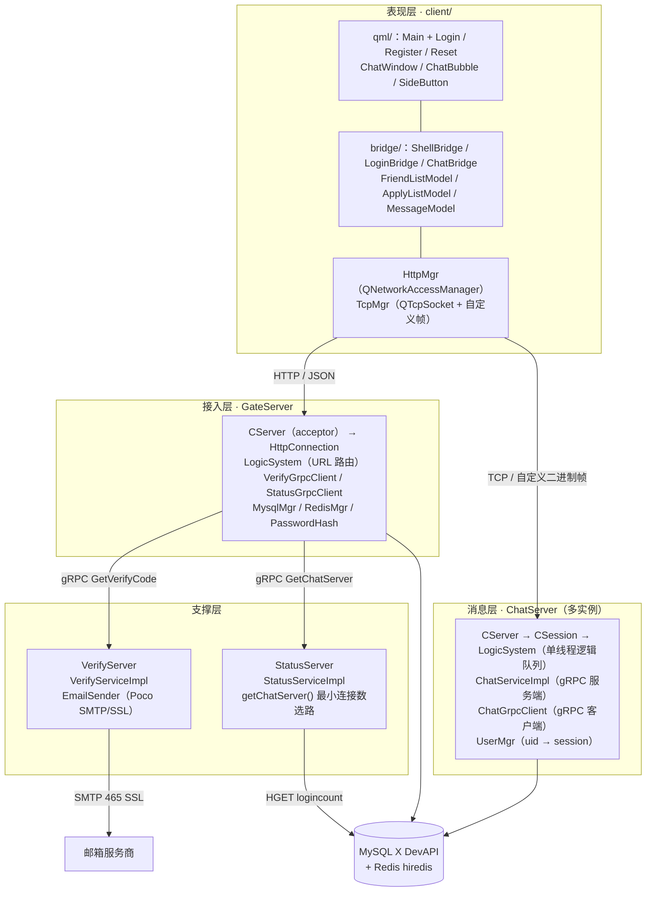
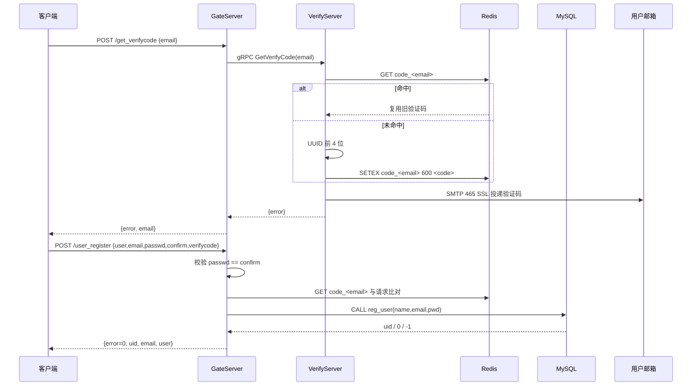
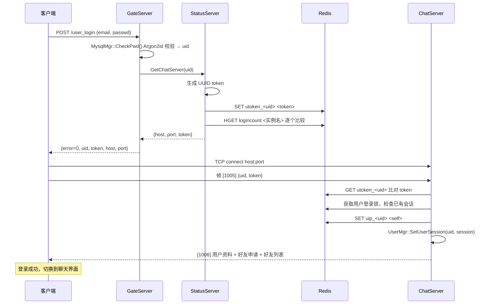
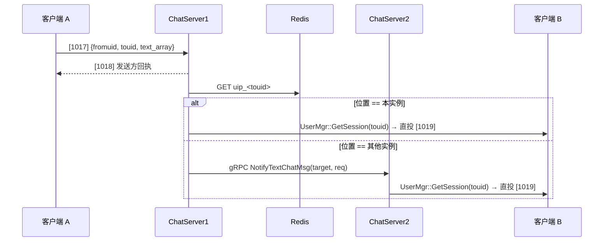
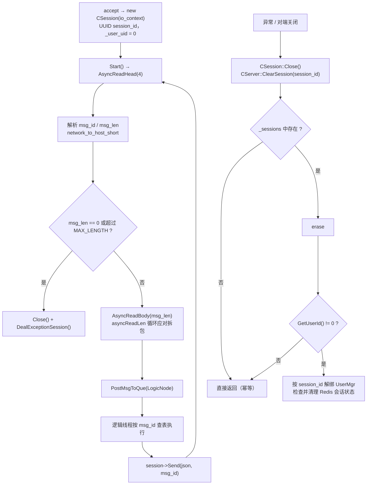

# 01 · 架构设计

## 1.1 设计取舍

要用 C++ 做出一套能横向扩展的即时通讯后端，下面三个决定基本框定了后面的所有实现。

**按职责切分服务，而不是按数据切分。** 四个进程各自拥有一份配置、线程池与连接池，
任一进程崩溃只影响它的直接依赖方，不会连带其他服务已经建立的连接。

**无状态网关 + 有状态聊天节点。** GateServer 不保存会话，只做协议转换与 RPC 编排；
长连接状态放在 ChatServer 进程内存里，用户落在哪个实例记在 Redis（`uip_<uid>`），
这样聊天节点可以随意加减。

**进程内状态优先。** 同实例的消息直投，既不落 Redis 也不落库；只有跨实例才走 gRPC。
Redis 只承担跨节点寻址与登录计数，持久化交给 MySQL。

## 1.2 系统分层

## 1.3 进程与线程模型

### GateServer

| 线程 | 数量 | 职责 |
| --- | --- | --- |
| 主线程 | 1 | 运行 `io_context`；承载 acceptor 与信号处理 |
| IOContextPool 线程 | `std::thread::hardware_concurrency()` | 每个线程一个 `io_context` + `work_guard`，承载 `HttpConnection` 的读写 |
| gRPC 内部线程 | 由 gRPC 管理 | RPC 调用回调 |

HTTP 请求处理是**同步的**：`LogicSystem` 的 handler 在 IO 线程中直接执行，其中包含
RPC 调用与数据库访问，会阻塞该 IO 线程。这是当前实现的吞吐瓶颈之一（见 `11-known-limitations.md`）。

### ChatServer

| 线程 | 数量 | 职责 |
| --- | --- | --- |
| 主线程 | 1 | 运行 `io_context`（acceptor + 信号） |
| IOContextPool 线程 | CPU 核心数 | 承载 `CSession` 的异步读写 |
| 逻辑线程 | 1 | `LogicSystem::DealMsg()` 消费逻辑队列，**串行**执行所有消息处理函数 |
| gRPC 等待线程 | 1（显式 `std::thread` + `server->Wait()`） | 等待服务关闭；RPC 由 gRPC 内部工作线程处理 |
| gRPC 客户端线程 | gRPC 内部 | 跨实例转发 |

**关键设计：逻辑单线程。** 所有 TCP 消息的处理函数在同一个线程内串行执行，
`UserMgr` 还会被 IO 和 gRPC 线程访问，因此映射由互斥锁保护。
`CSession::Send()` 将发送操作投递到 socket 所属 IO 线程，与读取、关闭串行执行。

### StatusServer / VerifyServer

主线程阻塞在 gRPC `server->Wait()`，信号处理跑在独立线程的 `io_context` 上（异步等待 SIGINT/SIGTERM 后调用 `Shutdown()`）。

## 1.4 核心流程时序

### 1.4.1 注册

### 1.4.2 登录与长连接建立

登录由 **HTTP 取票 + TCP 认证**两段组成：GateServer 只负责核实身份并发放 token，
真正的长连接在客户端与指定的 ChatServer 之间建立。

### 1.4.3 跨实例文本消息

发送方先拿回执（1018），接收方的投递结果不回传——即使对方离线，发送方看到的也是成功。

## 1.5 消息路由策略

| 场景 | 路径 | 说明 |
| --- | --- | --- |
| 同实例在线 | `UserMgr` 内存映射 → `CSession::Send()` | 零网络开销，逻辑线程内完成 |
| 跨实例在线 | `uip_<uid>` 定位实例名 → gRPC Stub 连接池 → 对端 `ChatServiceImpl` → `UserMgr` → `Send()` | 一次 RPC 跳转 |
| 目标离线 | 直接返回，消息丢弃 | **当前无离线消息**（见已知限制） |

`uip_<uid>` 在登录时写入，在会话清理时不删除（仅解绑 `UserMgr`），
因此离线用户仍会残留一个过期的位置值；由于离线判定最终以 `UserMgr::GetSession()` 返回空为准，
残留值不会导致错误投递，但会造成一次无效的 gRPC 调用。

## 1.6 连接池与资源池

| 资源 | 实现 | 容量 | 位置 |
| --- | --- | --- | --- |
| io_context 线程池 | `IOContextPool` | `hardware_concurrency()` | 四服务各自持有一份（模板相同、代码独立） |
| Redis 连接 | `RedisConPool`（hiredis） | 5 | `RedisMgr` |
| gRPC Stub | `RPConPool` / `ChatConPool` | 5 | `VerifyGrpcClient` / `ChatGrpcClient` |
| MySQL 会话 | `MysqlMgr` 内部池 | 见源码 | `MysqlDao` |

所有池均遵循同一模式：`std::queue` + `std::mutex` + `std::condition_variable`，
`b_stop_` 标志用于关闭时唤醒所有等待者。

## 1.7 会话生命周期（ChatServer）

`_user_uid == 0` 作为"未登录"哨兵值——真实 uid 从 1000 起分配，
未登录连接不操作 Redis 用户会话键；连接计数由定时器每 60 秒扫描上报。

## 1.8 容错边界

| 失效对象 | 当前行为 |
| --- | --- |
| Redis 不可用 | 命令失败可能返回 false；池内无连接或阻塞调用无超时时也可能一直等待 |
| MySQL 不可用 | 注册/登录/好友持久化失败 |
| 某 ChatServer 实例崩溃 | 该实例上的连接断开；旧计数没有 TTL，StatusServer 仍可能向该实例分配新连接 |
| StatusServer 不可用 | 登录返回 `RPCFailed(1002)` |
| VerifyServer / SMTP 不可用 | 验证码接口返回 `SendMailErr(3)` |
| 对端 ChatServer 不可达 | 跨实例转发返回 `RPCFailed`，消息静默丢弃 |
