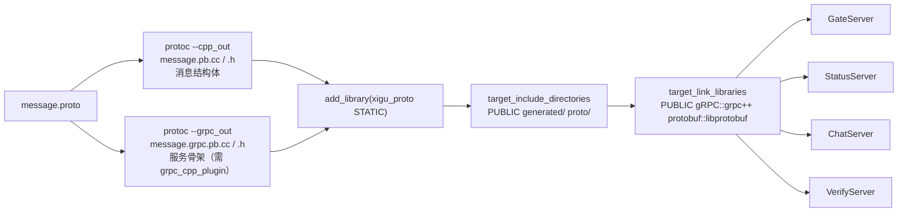

# 02 · 构建与部署

## 2.1 构建体系总览

项目由两个**完全独立**的 CMake 工程组成，互不依赖、可分别构建：

| 工程 | 根目录 | 语言标准 | 依赖来源 |
| --- | --- | --- | --- |
| 客户端 | `client/` | C++17 | 系统 Qt 6.5（`QT_ROOT` 或 Qt Kit） |
| 服务端 | `server/` | C++20 | vcpkg manifest（`server/vcpkg.json`） |

两者均使用 CMakePresets（version 6）描述三平台 × Debug/Release 组合，
命令行、VSCode、Qt Creator、Visual Studio 共用同一份预设。

## 2.2 前置条件

| 工具 | 版本要求 | 用途 |
| --- | --- | --- |
| CMake | ≥ 3.21（`server` 预设要求 ≥ 3.27） | 预设与 `$<TARGET_RUNTIME_DLLS>` |
| Ninja | 任意近期版本 | macOS/Linux 预设的默认生成器 |
| Visual Studio | 预设中为 "Visual Studio 18 2026" | Windows 后端预设 |
| vcpkg | 任意（需与 `builtin-baseline` 兼容） | 后端依赖，由 `VCPKG_ROOT` 定位 |
| Qt | 6.5.x（Core/Gui/Network/Widgets） | 客户端 |

### vcpkg 依赖的系统前置（macOS / Linux）

`libsodium` 端口在 macOS / Linux 上走 autotools 构建，vcpkg 不提供下列工具，需系统预装：

```bash
# macOS
brew install autoconf autoconf-archive automake libtool

# Debian / Ubuntu
sudo apt install autoconf autoconf-archive automake libtool

# Fedora / RHEL
sudo dnf install autoconf autoconf-archive automake libtool
```

Windows（MSVC）无需安装——该端口在 MSVC 下使用自带的 VS 工程。

## 2.3 后端构建

### 依赖清单（`server/vcpkg.json`）

```json
{
  "builtin-baseline": "b8b8df2201ad8509b81a830fe0957bcb98e06c27",
  "dependencies": [
    { "name": "grpc", "features": [ "codegen" ] },
    "protobuf", "boost-asio", "boost-beast", "boost-filesystem",
    "boost-property-tree", "boost-uuid", "hiredis", "jsoncpp",
    "libsodium", "mysql-connector-cpp",
    { "name": "poco", "features": [ "net", "netssl" ] }
  ]
}
```

`builtin-baseline` 是 manifest 级设置，只影响本项目的版本解析，不会改动 vcpkg 全局已编译的包。

### 工具链注入

`server/CMakeLists.txt` 在 `project()` **之前**设置 `CMAKE_TOOLCHAIN_FILE`：

```cmake
set(CMAKE_TOOLCHAIN_FILE "$ENV{VCPKG_ROOT}/scripts/buildsystems/vcpkg.cmake"
    CACHE FILEPATH "vcpkg toolchain file")
```

放在 `project()` 之前是必需的——CMake 在首次 `project()` 调用时加载 toolchain，
晚于此设置将不生效。由此命令行、IDE 等所有入口获得一致的构建环境。
未设置 `VCPKG_ROOT` 时会在配置期直接 `FATAL_ERROR` 并给出三平台设置指引。

### 预设清单

| configure 预设 | 生成器 | triplet | 构建类型 |
| --- | --- | --- | --- |
| `windows-msvc` | Visual Studio 18 2026 | `x64-windows` | 多配置（Debug/Release 由 build 预设选） |
| `macos-clang` | Ninja | `arm64-osx` | Debug |
| `macos-clang-release` | Ninja | `arm64-osx` | Release |
| `linux-gcc` | Ninja | `x64-linux` | Debug |
| `linux-gcc-release` | Ninja | `x64-linux` | Release |

对应的 build 预设：`windows-msvc-debug` / `windows-msvc-release` / `macos-clang` /
`macos-clang-release` / `linux-gcc` / `linux-gcc-release`。

```bash
cd server
export VCPKG_ROOT=/path/to/vcpkg

cmake --preset macos-clang
cmake --build --preset macos-clang
```

### proto 代码生成（`server/proto/`）

`proto/` 是**共享 proto 的单一源**，构建期生成代码并打包成静态库 `xigu_proto`，
四个服务统一链接，避免各服务重复维护 proto 与生成步骤。



`protoc` 与 `grpc_cpp_plugin` 通过 `find_program(... NO_DEFAULT_PATH REQUIRED)` 从
`${VCPKG_INSTALLED_DIR}/${VCPKG_TARGET_TRIPLET}/tools/` 精确定位，
避免误用系统里其他版本的 protobuf/gRPC（版本不匹配会导致生成代码与运行时 ABI 冲突）。

`add_custom_command` 用 `DEPENDS message.proto` 跟踪变更，改 proto 会自动触发重新生成。

### 各服务的公共链接项

| 目标库 | 用途 |
| --- | --- |
| `xigu_proto` | 共享 proto 生成代码 |
| `gRPC::grpc++` / `protobuf::libprotobuf` | RPC 运行时 |
| `Boost::filesystem` / `Boost::headers` | 路径处理；Asio/Beast/PropertyTree/Uuid |
| `hiredis::hiredis` | Redis 客户端 |
| `JsonCpp::JsonCpp` | JSON 序列化 |
| `unofficial-sodium::sodium` | Argon2id 口令哈希（仅 GateServer） |
| `unofficial::mysql-connector-cpp::connector` | MySQL X DevAPI（除 VerifyServer） |
| `Poco::NetSSL` / `Poco::Net` | SMTP over SSL（仅 VerifyServer） |
| `Threads::Threads` | 线程支持 |
| `ws2_32` | Windows Winsock（仅 WIN32） |

顶层 `CMakeLists.txt` 末尾对 GateServer / StatusServer / ChatServer 统一补链接
`zstd::libzstd` 与 `LZ4::lz4`：mysql-connector-cpp 的 X DevAPI 压缩功能引用这两个库的符号，
而 vcpkg 的 `unofficial` 配置不会自动传递该依赖，需显式补齐（顺序必须在 mysql 之后）。

## 2.4 ChatServer 多实例机制

### 设计

ChatServer **只有一套源代码**，实例完全由 `services/ChatServer/config/*.ini` 驱动：

| 配置文件 | 产物目录 | 实例名（`[SelfServer].Name`） |
| --- | --- | --- |
| `config/ChatServer.ini` | `bin/ChatServer/` | `chatserver1`（主实例） |
| `config/ChatServer2.ini` | `bin/ChatServer2/` | `chatserver2` |
| `config/ChatServer3.ini` | `bin/ChatServer3/` | 新增实例，无需改 CMake |

实现要点（见 `services/ChatServer/CMakeLists.txt`）：

1. `file(GLOB CONFIGURE_DEPENDS config/*.ini)` 扫描实例清单。
   `CONFIGURE_DEPENDS` 让 CMake 在新增/删除 ini 后自动重新配置。
2. 列表按名字排序，取**第一项**作为主实例（`CHAT_PRIMARY_NAME`）。
   可执行文件的直接产物目录即 `bin/<主实例名>/`。
3. 非主实例通过 POST_BUILD 的 `copy_directory` 从主实例目录**整目录复制**产物。
4. 每个实例再用 `copy_if_different` 部署自己的 ini（统一命名为 `config.ini`），
   该命令必须排在整目录复制**之后**，否则会被主实例带过来的 ini 覆盖。

### 为什么整目录复制

各平台依赖的落盘方式不同，但结论一致：

- **Windows**（vcpkg 动态 triplet）：将依赖 DLL 放在 exe 同目录，便于直接启动。vcpkg applocal 在链接后递归解析，
  把直接与间接依赖的 DLL 拷入主实例目录。
- **macOS / Linux**：默认 triplet 的多数依赖静态链接，但个别端口可提供动态库；
  构建产物通过 rpath 引用安装目录中的 `.dylib`/`.so`。

整目录复制保留可执行文件与已部署的库文件，使实例在同一构建环境下运行。
跨机器部署还需携带动态依赖并检查 rpath，不能把实例目录直接视为独立安装包。

### 多配置生成器的目录对齐

可执行文件的实际落点随生成器类型变化：

| 生成器类型 | 落点 |
| --- | --- |
| 单配置（Ninja / Makefile，本项目 macOS/Linux 预设） | `bin/<实例名>/` |
| 多配置（Visual Studio / Ninja Multi-Config，Windows 预设） | `bin/<实例名>/<配置名>/` |

CMakeLists 用 `CMAKE_CONFIGURATION_TYPES` 判断，并用生成器表达式 `$<CONFIG>` 表达配置层：

```cmake
if(CMAKE_CONFIGURATION_TYPES)
    set(CHAT_INSTANCE_DIR_SUFFIX "/$<CONFIG>")
else()
    set(CHAT_INSTANCE_DIR_SUFFIX "")
endif()
```

`$<CONFIG>` 在构建时才求值，同一份规则在三平台、Debug/Release 下都成立。

### 新增一个实例

1. 复制 `config/ChatServer.ini` 为 `config/ChatServerN.ini`；
2. 修改 `[SelfServer]` 的 `Name` / `Port` / `RPCPort`；
3. 修改 `[PeerServer] Servers` 为**除自己以外**的全部实例名，并为每个对端补 `[<实例名>]` 段
   （`Name` / `Host` / `Port`，其中 Port 是**对端的 RPC 端口**）；
4. 把新实例名加入 `StatusServer/config.ini` 的 `[chatservers] Name`，并补 `[<实例名>]` 段
   （`Host` 与**TCP 端口**，供客户端连接）；
5. 重新 configure + build，自动生成 `bin/ChatServerN/`。

> 注意两个"Port"语义不同：`StatusServer` 的 `[<实例>].Port` 是客户端连的 **TCP 端口**；
> ChatServer 的 `[<对端实例>].Port` 是服务间 **gRPC 端口**。

## 2.5 部署规则（`cmake/XiguChatCommon.cmake`）

`xiguchat_deploy(<target>)` 为 GateServer / StatusServer / VerifyServer 提供统一部署：

1. 拷贝 `config.ini` 到可执行文件目录（三平台通用——服务按 cwd 读取配置）；
2. 拷贝运行时 DLL（仅 Windows）。

Windows 的 DLL 由 `$<TARGET_RUNTIME_DLLS:${TARGET}>`（CMake 3.21+）在构建时自动收集
目标实际依赖的全部 DLL，自动适配 Debug/Release 命名，无需手工维护清单。
macOS / Linux 在本机构建环境中由 rpath 定位动态库；跨机器部署需另行处理。

## 2.6 客户端构建

### 编译器与 Qt 定位

| 平台 | 编译器 | 说明 |
| --- | --- | --- |
| macOS / Linux | 系统 clang / gcc | 无需额外设置 |
| Windows | Qt 配套 MinGW | `QT_MINGW_ROOT` 环境变量，或 Qt Creator 的 MinGW Kit |

Windows 的 `QT_MINGW_ROOT` **必须是与 Qt 6.5 配套的 MinGW 11.2**（即 Qt 安装包自带的
`mingw1120_64`），其他版本 ABI 不兼容。仅当 `CMAKE_CXX_COMPILER` 未由 Kit 指定时才用该环境变量。

Windows 图标资源由 MinGW 的 `windres` 编译。CMake 在 `project()` 前保留已有的
`CMAKE_RC_COMPILER` 或环境变量 `RC`；未指定时，优先从所选 C++ 编译器目录及
`QT_MINGW_ROOT/bin` 定位资源编译器。

Qt 查找顺序：先按默认路径 `find_package(Qt6 6.5 QUIET COMPONENTS ...)`，
失败且定义了 `QT_ROOT` 时把 `QT_ROOT` 追加到 `CMAKE_PREFIX_PATH` 再找一次，
仍失败则给出两种修复方式后 `FATAL_ERROR`。

### Qt 自动化

`CMAKE_AUTOMOC / AUTORCC` 全部开启：`Q_OBJECT` 类的 moc 代码、`.qrc` 资源编译均由 CMake
自动完成，源文件清单里只需列出 `.qrc` 即可。

### 目标划分

客户端拆成两个目标，分隔业务与界面：

| 目标 | 类型 | 内容 | 链接 |
| --- | --- | --- | --- |
| `xiguchat_core` | 静态库 | `core/`（全局定义、数据模型、服务层）+ `network/`（HTTP / TCP） | `Qt6::Core` `Qt6::Network` |
| `xiguchat` | 可执行 | `main.cpp` + `bridge/`（QML 边界）+ `qml/` + `resources/` | `xiguchat_core` + `Qt6::Gui` + `Qt6::Quick` |

`xiguchat_core` 的 include 目录以 `PUBLIC` 导出，桥接层源码里的 `#include "usermgr.h"`
无需改写。core 只依赖 Qt Core 与 Network，不包含窗口或 QML 代码。
本项目带 `QML_ELEMENT` 的类统一放在可执行目标的 `bridge/` 中，
由对应的 `qt_add_qml_module` 注册，不在 core 目标重复编译或注册。


### 平台差异化处理

| 事项 | 处理 |
| --- | --- |
| 子系统 | `add_executable(xiguchat WIN32 ...)`：Windows 生成 GUI 子系统程序（无控制台黑窗），入口仍为 `main()`；macOS/Linux 忽略该标志 |
| Windows 图标 | `resources/xiguchat.rc` 引用 `xiguchat.ico`，通过 windres 编译并嵌入 EXE，供资源管理器与快捷方式使用 |
| macOS 图标 | `MACOSX_BUNDLE` + `MACOSX_BUNDLE_ICON_FILE xiguchat.icns`，icns 打进 `Resources/`。macOS Dock 不读 Qt 资源，必须用 bundle + icns；`setWindowIcon` 在 macOS 窗口标题栏无效 |
| Windows Qt 运行库 | POST_BUILD 调用 `windeployqt --compiler-runtime --no-translations --qmldir <qml目录>`，把 Qt6 DLL、平台插件与 MinGW 运行时拷到产物目录 |
| 运行时资源 | `config.ini` 拷贝到 `$<TARGET_FILE_DIR:xiguchat>`（Windows/Linux 为 `bin/`，macOS 为 `.app/Contents/MacOS/`） |

QML 使用 `QtQuick.Effects` 绘制头像遮罩，使用 `QtCore.Settings` 保存日夜外观偏好；
部署时需要包含这些 QML 模块。外观偏好由应用标识定位到系统设置存储，不写入 `config.ini`。

`resources/xiguchat.svg` 是应用图标的原创主图；导出的 `xiguchat.png` 编入 qrc，
供 `BrandMark.qml` 与运行时窗口图标使用，ICO 与 ICNS 用于各平台系统图标。

产物：`build/<预设>/bin/xiguchat`（macOS 为 `xiguchat.app`）。

## 2.7 产物布局

构建产物集中在 `build/<预设>/bin/` 下的服务同名目录：

| 目录 | 内容 |
| --- | --- |
| `GateServer/` | `GateServer(.exe)` + `config.ini` + [Windows] `*.dll` |
| `StatusServer/` | `StatusServer(.exe)` + `config.ini` + [Windows] `*.dll` |
| `VerifyServer/` | `VerifyServer(.exe)` + `config.ini` + [Windows] `*.dll` |
| `ChatServer/` | `ChatServer(.exe)` + `config.ini`（实例 `chatserver1`） |
| `ChatServer2/` | `ChatServer(.exe)` + `config.ini`（实例 `chatserver2`） |

Windows 用多配置生成器，路径再多一层：`bin/<服务名>/<Debug|Release>/`。

## 2.8 运行方式

**每个服务必须在其自身目录下启动**——`ConfigMgr` 固定读取当前工作目录下的 `config.ini`：

```bash
cd build/macos-clang/bin

./VerifyServer/VerifyServer
./StatusServer/StatusServer
./ChatServer/ChatServer
./ChatServer2/ChatServer
./GateServer/GateServer
```

> 两个 ChatServer 实例用的是**同一个可执行文件**，区别只在各自目录下的 `config.ini`
> （`[SelfServer]` 的 Name/Port/RPCPort 与 `[PeerServer]` 指向）。

## 2.9 平台与生成器差异速查

| 维度 | Windows | macOS | Linux |
| --- | --- | --- | --- |
| 后端生成器 | Visual Studio（多配置） | Ninja（单配置） | Ninja（单配置） |
| 后端 triplet | `x64-windows`（动态） | `arm64-osx`（静态） | `x64-linux`（静态） |
| 依赖部署 | 需拷贝 DLL（applocal + `TARGET_RUNTIME_DLLS`） | 静态链接 / rpath | 静态链接 / rpath |
| 客户端编译器 | Qt 配套 MinGW 11.2 | AppleClang | GCC |
| 客户端 Qt 部署 | `windeployqt` | 系统路径 | 系统路径 |
| 客户端产物 | `bin/xiguchat.exe` | `bin/xiguchat.app` | `bin/xiguchat` |
| libsodium autotools 前置 | 不需要 | 需要 | 需要 |
| 系统 CA bundle | 通常无（OpenSSL 默认目录兜底） | `/etc/ssl/cert.pem` | `/etc/ssl/certs/ca-certificates.crt` |

## 2.10 常见问题

| 现象 | 原因与处理 |
| --- | --- |
| 配置期报 `未设置 VCPKG_ROOT` | 设置环境变量后**重新打开终端/IDE** 再 configure |
| 配置期报找不到 Qt 6.5 | 设置 `QT_ROOT`，或改用 Qt Creator 的 Qt 6.5 Kit |
| Windows 报 MinGW 相关错误 | `QT_MINGW_ROOT` 必须是 Qt 6.5 自带的 `mingw1120_64` |
| vcpkg 大量包重新编译 | Xcode 等编译器/工具链升级可能改变 vcpkg ABI 哈希。新工具链通常需要重新编译；只有 CLT 版本和原构建条件一致时，指定 `DEVELOPER_DIR` 才可能复用缓存 |
| `protoc` / `grpc_cpp_plugin` 找不到 | 确认 vcpkg triplet 下 `tools/protobuf` 与 `tools/grpc` 已安装（manifest 中 grpc 需带 `codegen` feature） |
| 链接报 zstd / lz4 符号未定义 | 顶层 CMakeLists 的补链接仅覆盖 Gate/Status/Chat；新增服务需自行补上 |
| 新增 ChatServer ini 后未生成目录 | `CONFIGURE_DEPENDS` 需重新 configure；若未自动触发，手动重跑 `cmake --preset ...` |

### protobuf 配置警告

当前 baseline 的 protobuf 端口通过 feature 映射向上游 CMake 传入
`protobuf_BUILD_TARGET_LIBPROTOC`。这是端口内部的判断变量，上游 protobuf 33.4
使用的是 `protobuf_BUILD_LIBPROTOC`，因此会提示前者未被使用。
端口同时传入了真正的构建选项，这条警告本身不表示 libprotoc 构建失败。

Xcode 升级导致依赖重新配置时可能重新看到这条警告；它不来自项目的 CMakeLists。
无需给项目添加同名变量，也不应修改 `build/` 下自动生成的 vcpkg 文件。
上游端口修复并更新 baseline 后可消除；依赖最终是否成功仍以构建结果为准。
