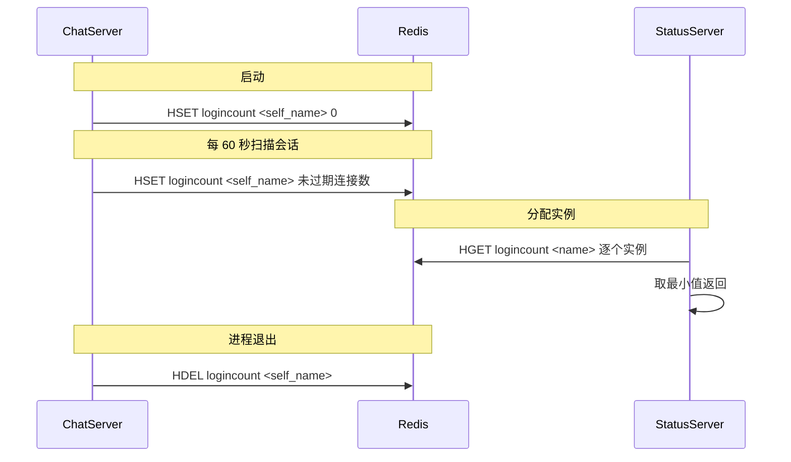
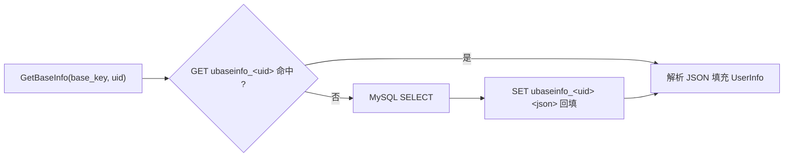

# 04 · 数据模型

数据分两层：**MySQL 负责持久化**（用户、好友关系、好友申请），**Redis 负责运行时状态**
（token、用户缓存、实例位置、连接计数、验证码）。

> 备份文件 `backup/xigu.sql` 已纳入版本管理，包含全部建表语句、`reg_user` 存储过程与初始数据，
> 导入即可复现完整的库结构，无需手工建表。

---

## 4.1 MySQL

数据库：`xigu`，字符集 `utf8mb4 / utf8mb4_unicode_ci`。
后端通过 **X DevAPI（X Protocol，默认 33060）** 访问，连接参数在各自 `config.ini` 的 `[Mysql]` 段。

### 表 `user`

| 列 | 类型 | 说明 |
| --- | --- | --- |
| `id` | int, AUTO_INCREMENT | 物理主键 |
| `uid` | int, UNIQUE | **业务用户 ID**，由 `user_id` 表递增分配 |
| `name` | varchar(255), INDEX | 用户名，唯一性由存储过程保证 |
| `email` | varchar(255), UNIQUE | 邮箱，登录账号 |
| `pwd` | varchar(255) | Argon2id 哈希串（`$argon2id$v=19$...`，约 98 字符） |
| `nick` | varchar(255) | 昵称 |
| `desc` | varchar(255) | 个性签名（SQL 中需反引号转义：`` `desc` ``） |
| `sex` | int | 性别：0 未知 / 1 女 / 2 男（客户端以 1 显示女性图标） |
| `icon` | varchar(255) | 头像，存 Qt 资源路径（如 `:/res/head_1.jpg`） |

### 表 `friend`

| 列 | 类型 | 说明 |
| --- | --- | --- |
| `id` | int unsigned, AUTO_INCREMENT | 主键 |
| `self_id` | int | 关系持有者 uid |
| `friend_id` | int | 好友 uid |
| `back` | varchar(255) | 备注名 |

唯一索引 `(self_id, friend_id)`。好友关系是**双向两行**：A 同意 B 的申请时，
`AddFriend` 会分别插入 `(A,B)` 与 `(B,A)`，用 `INSERT IGNORE` 避免重复。

### 表 `friend_apply`

| 列 | 类型 | 说明 |
| --- | --- | --- |
| `id` | bigint, AUTO_INCREMENT | 主键，同时用作分页游标 |
| `from_uid` | int | 申请人 |
| `to_uid` | int | 被申请人 |
| `status` | smallint, 默认 0 | 0 待处理 / 1 已同意 |

唯一索引 `(from_uid, to_uid)`；`AddFriendApply` 用
`ON DUPLICATE KEY UPDATE from_uid = from_uid` 保证重复申请不报错。

### 表 `user_id`

单行表，保存当前已分配的最大 uid。注册时 `UPDATE user_id SET id = id + 1` 后取回，
作为新用户的 uid。这是一把隐式的全局自增锁，位于 `reg_user` 事务内。

### 存储过程 `reg_user`

```sql
CREATE PROCEDURE reg_user(IN new_name VARCHAR(255), IN new_email VARCHAR(255),
                          IN new_pwd   VARCHAR(255), OUT result INT)
```

| 返回值 | 含义 |
| --- | --- |
| `-1` | 执行异常（已 `ROLLBACK`） |
| `0` | 用户名或邮箱已存在 |
| `>0` | 新分配的 uid |

流程：`START TRANSACTION` → 检查 name → 检查 email → `user_id` 自增 → 插入 `user` → `COMMIT`。
`DECLARE EXIT HANDLER FOR SQLEXCEPTION` 负责回滚并返回 -1。

> **重要**：`new_pwd` 存的是 DAO 层算好的 Argon2id 哈希串，存储过程只做搬运，
> 因此数据库里**不存在明文密码**。

---

## 4.2 Redis

连接：hiredis，连接池容量 5，启动即 `AUTH`。
键前缀常量定义在 `ChatServer/include/const.h`（其他服务复制了各自需要的部分）。

| 键 | 类型 | 写入方 | 读取方 | TTL | 说明 |
| --- | --- | --- | --- | --- | --- |
| `code_<email>` | String | VerifyServer | GateServer | 600s | 验证码，`SETEX` 写入 |
| `utoken_<uid>` | String | StatusServer | ChatServer | 无 | 登录令牌（UUID） |
| `uip_<uid>` | String | ChatServer | ChatServer | 无 | 该用户当前所在实例名 |
| `ubaseinfo_<uid>` | String(JSON) | ChatServer | ChatServer | 无 | 按 uid 缓存的用户资料 |
| `nameinfo_<name>` | String(JSON) | ChatServer | ChatServer | 无 | 按用户名缓存的用户资料 |
| `logincount` | Hash | ChatServer | StatusServer | 无 | field=实例名，value=在线连接数 |

未使用的历史前缀：`ipcount_`（`IPCOUNTPREFIX`），当前代码中无引用。

### `logincount` 与最小连接数调度



设计要点：

- 计数是扫描快照，包含尚未登录但未超时的 TCP 连接，不是严格的在线用户数。
- 登录与断连不直接增减计数，调度数据最多滞后一个扫描周期。
- StatusServer 跳过缺失、非法计数；全部无效时返回失败。
- 计数没有 TTL，实例崩溃可能留下旧值，需要独立的探活机制。

### 用户资料缓存策略

`GetBaseInfo(base_key, uid, userinfo)` 是标准的 **Cache-Aside**：



有三处需要注意：

1. 缓存**无 TTL、无失效**：修改资料后需主动失效或手工删键，仅重启进程不会清空 Redis。
2. 资料缓存读写均不使用 `pwd`，已有 Redis 键中的历史字段不会因更新程序自动删除。
3. `GetBaseInfo` 在 `LogicSystem`、`ChatServiceImpl`、`ChatGrpcClient` 三处重复实现，
   逻辑完全一致——是明确的重复代码，应收敛到 `UserMgr` 或独立的 `UserCache` 组件。

### 验证码的复用语义

`VerifyServiceImpl::GetVerifyCode` 先 `GET code_<email>`：

- 命中 → **复用旧验证码**，不再生成、但仍会再发一次邮件；
- 未命中 → 生成新验证码并 `SETEX 600`。

因此在 10 分钟有效期内重复点击"获取验证码"，用户会收到多封内容相同的邮件。

---

## 4.3 客户端侧数据（`client/core/userdata.h`）

客户端不直接访问数据库，用下列结构承载服务端下发的数据：

| 结构 | 用途 |
| --- | --- |
| `SearchInfo` | 用户搜索结果 |
| `AddFriendApply` | 收到的好友申请（通知） |
| `ApplyInfo` | 好友申请列表项（含 `status`） |
| `AuthInfo` / `AuthRsp` | 同意好友申请的双向通知与响应 |
| `FriendInfo` | 好友（含 `_chat_msgs` 会话记录） |
| `UserInfo` | 当前登录用户 / 好友通用资料 |
| `TextChatData` / `TextChatMsg` | 单条文本消息 / 一批消息 |

`UserMgr`（单例）持有 token、好友列表、申请列表与分页游标
（`_chat_loaded` / `_contact_loaded`，每页 13 条），是 UI 层唯一的数据源。

---

## 4.4 未落库的数据

| 数据 | 现状 |
| --- | --- |
| 聊天消息 | **不落库**。`friend_apply` / `friend` / `user` 之外没有消息表，聊天记录仅存在于客户端内存（进程退出即丢失） |
| 离线消息 | 无存储与重投机制 |
| 消息送达状态 | 客户端收到 1018 回执后未做任何 UI 标记（源码中留有 TODO） |
