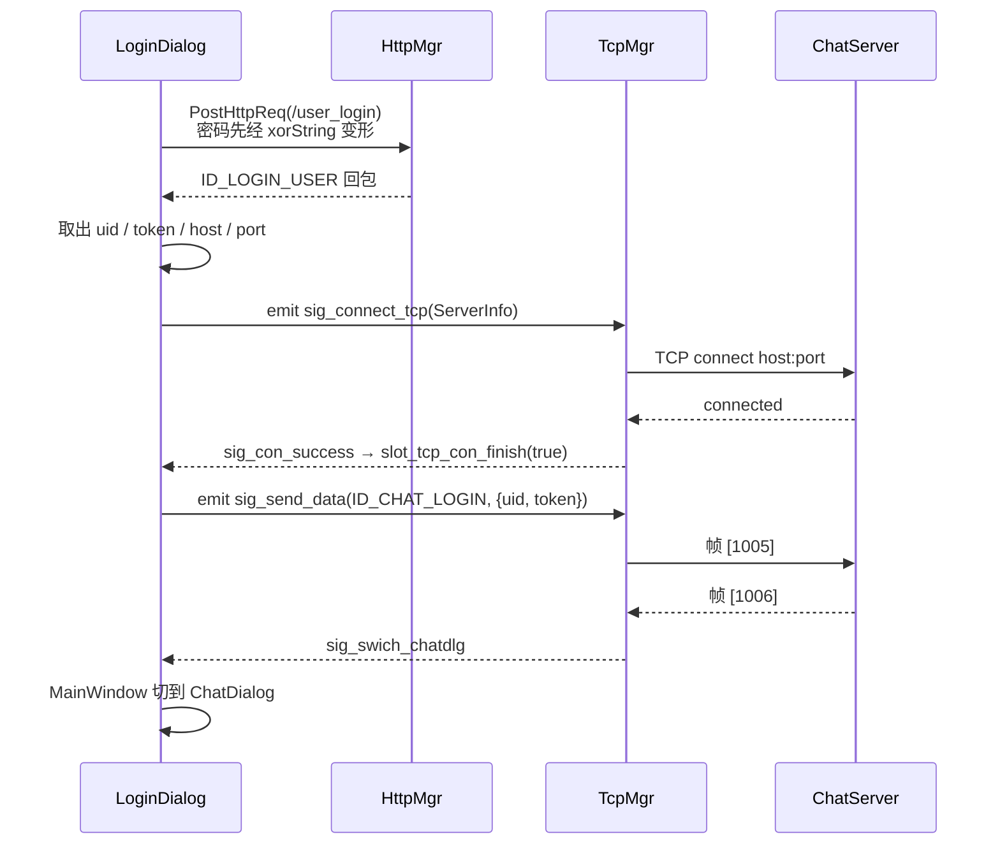
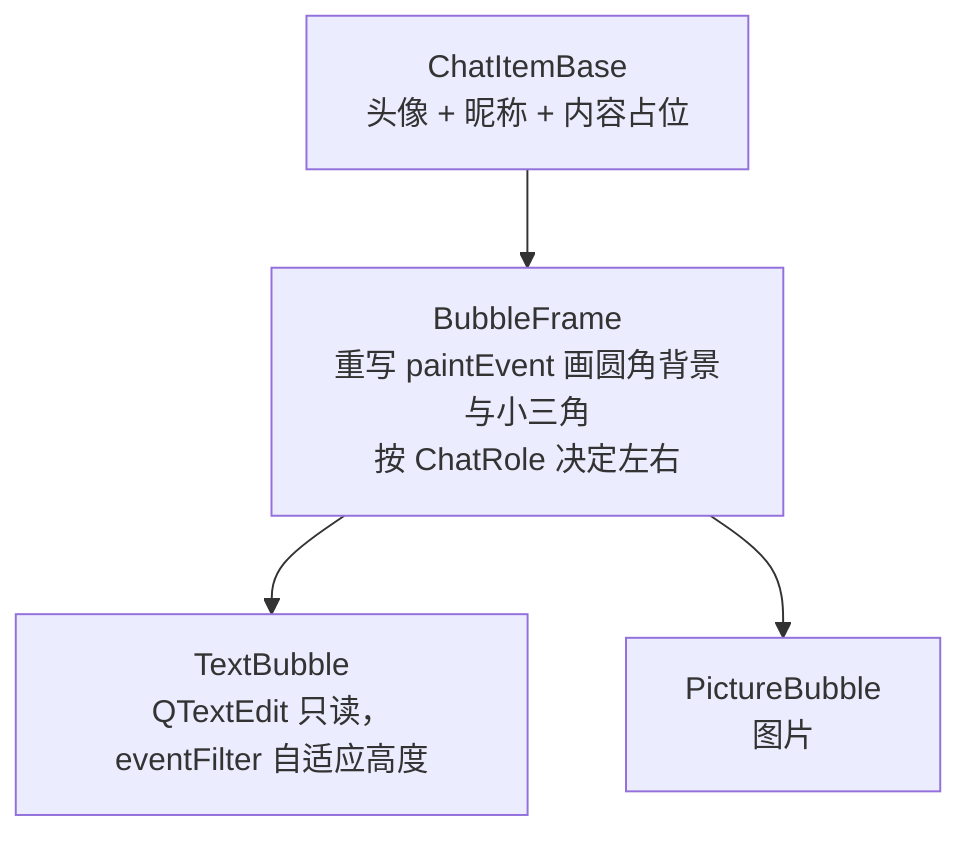

# 06 · 客户端（Qt 6）

## 6.1 技术概览

| 项 | 值 |
| --- | --- |
| 语言 / 标准 | C++17 |
| Qt 版本 | 6.5（Core / Gui / Widgets / Network） |
| UI 方式 | `.ui` 文件（Qt Designer）+ 代码动态装配，AUTOUIC 自动编译 |
| 样式 | 单一 QSS（`resources/style/stylesheet.qss`，约 770 行）在 `main()` 全局加载 |
| 资源 | Qt 资源系统 `resources/rc.qrc`，路径前缀 `:/` |
| 目标名 | `xiguchat`（macOS 为 `xiguchat.app`） |

## 6.2 分层结构

`main.cpp` 负责加载 QSS、读取 `config.ini` 拼网关 URL、显示 `MainWindow`，其余模块按下面四层划分。

**views — 主窗口**

| 文件 | 说明 |
| --- | --- |
| `mainwindow` | 页面切换容器：Login ⇄ Register / Reset，登录成功后切到 ChatDialog |

**dialogs — 业务页面**

| 文件 | 说明 |
| --- | --- |
| `logindialog` | 登录：邮箱/密码校验 → HTTP → 建 TCP → 发 1005 |
| `registerdialog` | 注册：验证码倒计时、邮箱/密码/确认校验 |
| `resetdialog` | 重置密码 |
| `chatdialog` | 聊天主界面（侧边栏 + 列表 + 会话区） |
| `chatpage` | 单个会话页面 |
| `applyfriend` | 搜索并添加好友 |
| `applyfriendpage` | 好友申请列表页 |
| `authenfriend` | 同意好友申请（填备注名） |
| `friendinfopage` | 好友资料页 |
| `contactuserlist` | 联系人列表 |
| `findsuccessdlg` / `findfaildlg` | 搜索成功 / 失败弹窗 |
| `loadingdlg` | 加载动画（QMovie + GIF） |

**widgets — 自定义控件**

| 文件 | 说明 |
| --- | --- |
| `chatitembase` `bubbleframe` `textbubble` `picturebubble` | 消息气泡 |
| `listitembase` `chatuserwid` `conuseritem` `adduseritem` `applyfrienditem` `grouptipitem` `searchlist` | 列表项 |
| `statewidget` `clickedlabel` `clickedbtn` `clickedoncelabel` | 状态与可点击控件 |
| `messagetextedit` | 消息输入框，支持图片/文件拖入 |
| `customizeedit` | 带占位提示的输入框 |
| `friendlabel` | 好友标签 |
| `timerbtn` | 获取验证码倒计时按钮 |

**network 与 core — 通信层与基础设施**

| 文件 | 说明 |
| --- | --- |
| `httpmgr` | HTTP 短连接（QNetworkAccessManager） |
| `tcpmgr` | TCP 长连接（QTcpSocket）+ 自定义帧编解码 |
| `global` | 枚举（`ReqId` / `Modules` / `TipErr` / `ErrorCodes` / `ListItemType`）与全局函数 |
| `singleton` | CRTP 单例模板（`std::once_flag` + `shared_ptr`） |
| `userdata` | 数据结构（`SearchInfo` / `ApplyInfo` / `FriendInfo` / `TextChatMsg`） |
| `usermgr` | 登录用户、好友列表、申请列表与分页游标 |

## 6.3 启动流程

`main.cpp`：

1. `QApplication` + `setWindowIcon(QIcon(":/res/Facebook.ico"))`
   （Windows/Linux 显示在标题栏与任务栏；macOS 标题栏不显示图标，Dock 图标来自 bundle 内的 `.icns`）；
2. 读取 `:style/stylesheet.qss` 并 `setStyleSheet` 应用于整个应用；
3. 用 `QSettings` 读可执行文件同目录的 `config.ini`，拼出 `gate_url_prefix = "http://host:port"`；
4. 显示 `MainWindow`。

## 6.4 通信层

### `HttpMgr`（HTTP 短连接）

- 继承 `QObject` + `Singleton<HttpMgr>` + `enable_shared_from_this`；
- `PostHttpReq(QUrl, QJsonObject, ReqId, Modules)` 用 `QNetworkAccessManager` 发 POST；
- 回包后按 `Modules` 分发信号：`sig_reg_mod_finish` / `sig_reset_mod_finish` / `sig_login_mod_finish`，
  通用信号为 `sig_http_finish`。这样各页面只需连接自己模块的信号，解耦了网络层与 UI。

### `TcpMgr`（TCP 长连接）

- 构造函数中连接 `connected` / `readyRead` / `errorOccurred` / `disconnected`，并调用
  `initHandlers()` 注册 `QMap<ReqId, std::function<...>>` 分发表；
- **粘包/半包处理**：`readyRead` 累积到 `_buffer`，用 `_b_recv_pending` 标记"头部已解析、等待完整包体"，
  循环拆帧；
- **发送**：`QDataStream` 设为 `BigEndian`，写 `quint16 id` + `quint16 len`，再 append JSON；
- 对外信号：`sig_con_success` / `sig_login_failed` / `sig_swich_chatdlg` /
  `sig_user_search` / `sig_friend_apply` / `sig_add_auth_friend` / `sig_auth_rsp` / `sig_text_chat_msg`。

> `sig_send_data` → `slot_send_data` 是自身信号到自身槽的连接，
> 目的是让 UI 线程之外的调用也能安全地触发发送（Qt 信号跨线程排队）。

### 登录的两阶段握手



## 6.5 UI 层设计要点

### 页面切换

`MainWindow` 用 `setCentralWidget` 切换页面，并把各页面设为
`Qt::CustomizeWindowHint | Qt::FramelessWindowHint`（嵌入主窗口，取消原生边框）。
登录成功后同时调整最小尺寸 `900×650`，并解除最大尺寸限制。

### 三态控件

`ClickedLabel` / `StateWidget` 都实现了"六态"样式模型：
`normal / normal_hover / normal_press`，`selected / selected_hover / selected_press`。
运行时通过 `setProperty("state", ...)` + 全局 `repolish()`（`unpolish` + `polish`）刷新 QSS，
避免重建控件。侧边栏的"聊天/联系人"图标与红点提示由 `StateWidget` 承担。

### 消息气泡



`ChatRole`（`Self` / `Other`）决定气泡方向与三角朝向。

### 消息输入

`MessageTextEdit` 继承 `QTextEdit`，重写 `dragEnterEvent` / `dropEvent` /
`canInsertFromMimeData` / `insertFromMimeData`，支持拖入图片与文件；
`getMsgList()` 返回 `QVector<MsgInfo>`，`msgFlag` 区分
`"text" / "image" / "file"`。`keyPressEvent` 中回车发送（`emit send()`）。
当前服务端只实现文本消息，图片/文件走的是本地预览，不会真正投递。

### 列表与分页

`ChatDialog` 用 `QListWidget` + `ListItemType` 区分项类型
（`CHAT_USER_ITEM` / `CONTACT_USER_ITEM` / `SEARCH_USER_ITEM` / `GROUP_TIP_ITEM` /
`APPLY_FRIEND_ITEM` …），滚动到底触发 `loadMoreChatUser()` / `loadMoreConUser()`，
每页 13 条（`CHAT_COUNT_PER_PAGE`），游标由 `UserMgr` 维护。

### HiDPI 处理

图片统一按设备像素比预渲染：

```cpp
qreal dpr = label->devicePixelRatioF();
QPixmap scaled = src.scaled(size * dpr, Qt::KeepAspectRatio, Qt::SmoothTransformation);
scaled.setDevicePixelRatio(dpr);
```

`global.h` 提供 `scalePixmapForLabel(src, targetSize, dpr)` 复用该逻辑。
用 `QPainterPath` 画圆角时，`QPainter` 使用逻辑坐标，矩形尺寸需**除以 dpr**。

## 6.6 数据与状态

`UserMgr`（单例）是 UI 层唯一数据源：

| 成员 | 用途 |
| --- | --- |
| `_token` / `_user_info` | 当前登录用户 |
| `_apply_list` | 好友申请 |
| `_friend_list` / `_friend_map` | 好友列表与 uid→好友 索引 |
| `_chat_loaded` / `_contact_loaded` | 分页游标 |

`AlreadyApply()` / `CheckFriendById()` 用于搜索结果页判断"已申请/已是好友"，
从而切换按钮状态。

## 6.7 资源与样式

| 资源 | 位置 | 说明 |
| --- | --- | --- |
| 图标 PNG | `resources/res/` | 侧边栏三态、性别、表情、关闭按钮等 |
| 头像 | `resources/res/head_1..5.jpg` | 同时也在 qrc 中；`static/head_1..2.jpg` 为运行时拷贝 |
| 加载动画 | `resources/res/loading.gif` | `QMovie` 播放 |
| 样式表 | `resources/style/stylesheet.qss` | 全局加载 |
| 应用图标 | `resources/Facebook.ico`、`resources/xiguchat.icns` | Windows/Linux 用 ico；macOS bundle 用 icns |

`rc.qrc` 中 `Facebook.ico` 的 alias 为 `res/Facebook.ico`，代码中以 `:/res/Facebook.ico` 引用。

## 6.8 输入校验

| 规则 | 位置 | 说明 |
| --- | --- | --- |
| 邮箱 | `LoginDialog::checkEmailValid()` | 正则 `(\w+)(\.|_)?(\w*)@(\w+)(\.(\w+))+` |
| 密码 | `checkPwdValid()` | 长度 6~15，字符集 `[a-zA-Z0-9!@#$%^&*.]` |
| 错误提示 | `AddTipErr` / `DelTipErr` | 用 `QMap<TipErr,QString>` 累积，全部消除后才清空提示区 |

## 6.9 与安全相关的实现现状

| 事项 | 现状 |
| --- | --- |
| 密码传输 | `xorString()` 做可逆 XOR 变形（按字符串长度取模，只处理前 `len % 255` 个字符），**不是加密**，且 HTTP 未启用 TLS |
| 本地存储 | 不保存密码或 token |
| 输入注入 | HTTP 走 JSON；MySQL 走 X DevAPI 的参数化 `sql("... ?").bind()`，无字符串拼接 |

## 6.10 客户端侧已知缺口

- 无断线重连：TCP 断开后仅打印日志。
- 无心跳：长时间空闲连接被中间设备回收后无法感知。
- 消息送达状态未做 UI 标记（`ID_TEXT_CHAT_MSG_RSP` 处理函数中留有 TODO）。
- 聊天记录仅存内存，重启即丢失。
- 图片/文件消息可在输入框中插入，但服务端不支持投递。
