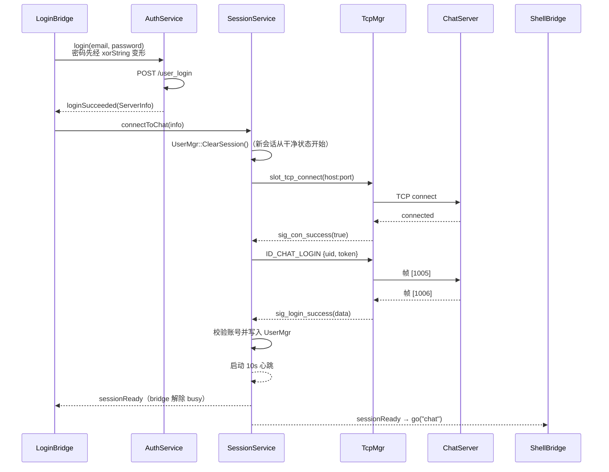

# 06 · 客户端（Qt 6 / QML）

## 6.1 技术概览

| 项 | 值 |
| --- | --- |
| 语言 / 标准 | C++17 |
| Qt 版本 | 6.5（Core / Gui / Network / Quick） |
| UI 方式 | QML，`qt_add_qml_module` 编入 qrc，入口 `qml/Main.qml` |
| 样式 | `qml/Theme.qml` 单例（设计令牌），**无样式表文件** |
| 资源 | `resources/rc.qrc`：应用图标 + 输入框明暗密码图标 + 内置头像 |
| 目标名 | `xiguchat`（macOS 为 `xiguchat.app`） |

QML 负责布局、焦点、动画和弹窗的临时表单状态；业务状态与网络协议由 C++ 管理。
页面通过 `Q_INVOKABLE` 发起动作，通过 `Q_PROPERTY` 与列表模型读取结果。

## 6.2 分层结构

`main.cpp` 只做三件事：创建 `QGuiApplication`、从 `config.ini` 拼出网关 URL、加载根窗口。
界面调用方向为 `qml → bridge → core/service → network`。`core/userdata` 是共享数据类型，
`UserMgr` 是会话数据源；网络层解析消息后发信号，由服务层更新数据，不负责切换页面。

**qml — 界面**

| 文件 | 说明 |
| --- | --- |
| `Main.qml` | 根 `Window`：持有 `ShellBridge`，用 `Loader` 换页并按页设窗口尺寸；掉线提示浮层 |
| `Login` / `Register` / `Reset` | 认证三页，共用 `AuthPage` 外壳（浅暖底 + 居中定宽列） |
| `ChatWindow` | 聊天主界面：侧栏 + 左列（会话 / 联系人）+ 右侧页面栈 |
| `FriendDialogs` | 搜索结果、添加好友与验证申请的弹层及临时表单 |
| `Avatar` | 显示已有头像，无头像时回退名字首字；软件渲染时不启用遮罩特效 |
| `ChatPage` | 会话页：标题 + 消息流 + 输入区 |
| `FriendInfoPage` | 好友资料页：头像 / 名字（含性别图标）/ 昵称 / 备注 / 标签 + 发消息、语音、视频 |
| `ApplyFriendPage` | 好友申请页：申请人 + 申请信息 + 添加 / 已添加 |
| `ChatBubble` | 可选中复制的文本气泡，以及图片预览 |
| `Theme.qml` | 设计令牌单例：颜色、字号、圆角、气泡最大宽度 |
| `AppInput` / `AppButton` / `AppLink` / `CodeButton` / `SideButton` / `IconButton` / `Spacer` / `AuthPage` | 组件 |

**bridge — QML 与 C++ 的边界**

| 文件 | 说明 |
| --- | --- |
| `shellbridge` | 当前页面（`page`）、掉线提示（`notice`）、`go(target)`；接管踢人与断线信号 |
| `pagebridge` | 页面基类，只提供 `go(target)` 导航契约 |
| `loginbridge` / `registerbridge` / `resetbridge` | 认证三页的状态与动作，含输入校验、验证码倒计时、错误文案 |
| `chatbridge` | 三个列表模型 + 选中会话 + 发消息 + 搜索/加好友/同意申请 |
| `friendlistmodel` | 会话与联系人共用：`uid / name / nick / icon / desc / lastText / initial` |
| `applylistmodel` | 好友申请，另有 `pendingCount` 供侧栏红点使用 |
| `messagemodel` | 当前会话的文本、头像与本地图片角色，增量插入 |
| `composerbridge` | 图片插入、粘贴纯文本、按顺序提取片段、按好友保存草稿 |

**core — 业务与数据**

| 文件 | 说明 |
| --- | --- |
| `service/authservice` | HTTP 认证：登录、验证码、注册、重置；服务端错误码 → 界面文案 |
| `service/sessionservice` | 会话生命周期：TCP 登录、12s 超时、10s 心跳；登录数据与消息/好友通知写入 UserMgr |
| `service/chatservice` | 文本按 JSON 字节数分帧、发送与本地记录 |
| `service/friendservice` | 搜索用户、发起申请、通过申请 |
| `global` | 枚举（`ReqId` / `Modules` / `ErrorCodes`）、`gate_url_prefix`、`ServerInfo` |
| `singleton` | CRTP 单例模板（`std::once_flag` + `shared_ptr`） |
| `userdata` | 数据结构（`SearchInfo` / `ApplyInfo` / `FriendInfo` / `TextChatMsg`） |
| `usermgr` | 登录用户、好友与申请列表；变更时发信号，列表模型据此刷新 |

**network — 传输**

| 文件 | 说明 |
| --- | --- |
| `httpmgr` | HTTP 短连接（`QNetworkAccessManager`），按 `Modules` 分发回包 |
| `tcpmgr` | TCP 长连接（`QTcpSocket`）+ 自定义帧编解码 |

## 6.3 启动流程

`main.cpp`：

1. `QGuiApplication` + `setWindowIcon(QIcon(":/res/Facebook.ico"))`
   （Windows/Linux 显示在标题栏与任务栏；macOS 标题栏不显示图标，Dock 图标来自 bundle 内的 `.icns`）；
2. 用 `QSettings` 读可执行文件同目录的 `config.ini`，拼出 `gate_url_prefix = "http://host:port"`；
3. `QQmlApplicationEngine::load("qrc:/qt/qml/XiguChat/qml/Main.qml")`。

`Main.qml` 在 `Component.onCompleted` 里装入登录页并把窗口定到 `380×470`。
窗口尺寸随页面变化：认证三页固定（470 / 560 / 500 高），聊天页最小 `900×650` 且可拉伸。

## 6.4 通信层

### `HttpMgr`（HTTP 短连接）

- 继承 `QObject` + `Singleton<HttpMgr>` + `enable_shared_from_this`；
- `PostHttpReq(QUrl, QJsonObject, ReqId, Modules)` 用 `QNetworkAccessManager` 发 POST；
- 回包后按 `Modules` 分发：`sig_reg_mod_finish` / `sig_reset_mod_finish` / `sig_login_mod_finish`，
  通用信号为 `sig_http_finish`。这样各服务只需连接自己模块的信号。

### `TcpMgr`（TCP 长连接）

- 构造函数中连接 `connected` / `readyRead` / `disconnected` / `errorOccurred`，并调用
  `initHandlers()` 注册 `QMap<ReqId, std::function<...>>` 分发表；
- **粘包/半包处理**：`readyRead` 累积到 `_buffer`，用 `_b_recv_pending` 标记"头部已解析、等待完整包体"，
  循环拆帧；
- **发送**：`QDataStream` 设为 `BigEndian`，写 `quint16 id` + `quint16 len`，再 append JSON；
- 对外信号：`sig_con_success` / `sig_con_failed` / `sig_login_failed` / `sig_login_success` /
  `sig_user_search` / `sig_friend_apply` / `sig_add_auth_friend` / `sig_auth_rsp` / `sig_text_chat_msg` /
  `sig_notify_offline` / `sig_connection_closed`。

> `sig_send_data` → `slot_send_data` 是自身信号到自身槽的连接，
> 目的是让 UI 线程之外的调用也能安全地触发发送（Qt 信号跨线程排队）。
>
> `sig_con_failed` 挂在 `QAbstractSocket::errorOccurred` 上（排除 `RemoteHostClosedError`），
> 让"连不上"在 1 秒内就能提示，而不是等超时。

### 登录的两阶段握手



## 6.5 QML 层设计要点

### 页面切换

`ShellBridge` 是唯一持有"当前页面"的对象。QML 里 `bridge.go("register")` → `ShellBridge::go()`
→ `page` 变化 → `Main.qml` 用 `Loader.setSource()` 重建页面并调整窗口尺寸。

登录、注册、重置和聊天之间切换时 Loader 销毁上一页并创建新页。`setSource()` 与
`source` 绑定都能在 URL 变化时完成这一点；相同 URL 的赋值不保证重建。
认证请求处理中禁止离开当前表单，防止迟到的回包被新表单接收。

### 主题

颜色、字号、间距、圆角全部在 `qml/Theme.qml`（`pragma Singleton`）。
`CMakeLists.txt` 中 `set_source_files_properties(qml/Theme.qml PROPERTIES QT_QML_SINGLETON_TYPE TRUE)`
必须写在 `qt_add_qml_module` **之前**，否则单例属性全读成 `undefined`。

### 消息气泡

气泡尺寸完全由内容推导，没有一处手工测量：

```qml
TextMetrics { id: metrics; font: label.font; text: root.text }
// 自然宽度与上限取小 → 按该宽度排版 → implicitHeight 回推气泡高度
```

`wrapMode: Text.WrapAtWordBoundaryOrAnywhere` 负责断行，长英文单词与长数字串都留在气泡内。
小三角是一个旋转 45° 的圆角矩形，一半压在气泡边缘下，同色无缝。

> 中文正文**不要叠加 `lineHeight` 倍率**：屏显中文字体的行盒（约 1.4em）已经够宽松，
> 再乘系数会把多出来的高度全堆在基线下方，表现为"上紧下松"。

### 左列模式与右侧页面

左列 `mode`（`ChatBridge::mode`）与右侧 `pane` 一起决定界面，和旧版 `ChatDialog` 的
`_state` + `QStackedWidget` 对应。**点侧栏会同时切左列和右侧**：

| 操作 | mode | 右侧 pane |
| --- | --- | --- |
| 点侧栏「聊天」 | 0 会话 | 当前会话（没有会话则空态） |
| 点侧栏「联系人」 | 1 联系人 | 好友申请页（旧版 `slot_side_contact` 就是直接切到 `friend_apply_page`） |
| 会话列表点条目 | 0 | 聊天页 `openChat(uid)` |
| 联系人列表点条目 | 1 | 好友资料页 `openProfile(uid)` |
| 资料页点「发消息」 | 0 | 聊天页 |
| 联系人列表「新的朋友」 | 1 | 好友申请页 `openApplyList()` |

联系人列表顶部按分组排布：「新的朋友」分组标题 → 新的朋友条目 →「联系人」分组标题 → 好友列表，
把搜索框、申请入口和已有联系人分开放。

联系人列表顶部按分组排布：「新的朋友」分组标题 → 新的朋友条目 →「联系人」分组标题 → 好友列表，
把搜索框、申请入口和已有联系人分开放。

三页都是 `ChatWindow` 的子项，用 `visible` 切换而不是重建，滚动位置和输入内容不会丢。
资料页与申请页来自旧版 `FriendInfoPage` / `ApplyFriendPage`；语音、视频按需求先做出图标，
服务端没有对应能力，因此显示为不可用状态，不做成"点了没反应"的按钮。

资料页的**昵称、备注、标签、性别**在服务端还没有对应字段（旧版 `sex_lb` 从未被赋值，
`bak_lb` 显示的还是昵称），界面先把位置留好：性别按 `sex` 1 男 / 2 女 画图标，其它值不显示；
标签为空时显示 `—`。

资料页的**昵称、备注、标签、性别**在服务端还没有对应字段（旧版 `sex_lb` 从未被赋值，
`bak_lb` 显示的还是昵称），界面先把位置留好：性别按 `sex` 1 男 / 2 女 画图标，其它值不显示；
标签为空时显示 `—`。

### 搜索

搜索框回车发 `ID_SEARCH_USER_REQ`，结果按旧版三条分支处理：

| 结果 | 行为 |
| --- | --- |
| 搜到自己 | 忽略，清空搜索态 |
| 已经是好友 | 不弹窗，直接跳到该好友的会话 |
| 陌生人 | 弹「添加到通讯录」卡片，点进去打开加好友弹窗 |
| 没搜到 | 弹「无法找到该用户 / 请检查你填写的账号是否正确」 |

加好友弹窗（旧版 `ApplyFriend`）包含：发送添加朋友申请（默认填自己的用户名）、
备注名（默认填对方名字）、标签选择。标签是「预设标签云 + 已选 chip」双联动的：
点预设标签加入已选并高亮，点 chip 上的 × 移除。几个说明：

- 标签布局用 `Flow` + `Repeater`，容器宽度一变自动重排，旧版是手工累加 x/y 坐标；
- **标签不发往服务端**：`ID_ADD_FRIEND_REQ` 只有 `uid / applyname / bakname / touid`，
  旧版同样只存在界面里，这里保持一致。

### 消息排列

消息从**顶部**开始往下排，超出可视高度后自动滚到最新一条：
列表顶对齐 + `positionViewAtEnd()`，消息少时也贴着顶部，不会沉到底部。

### 消息输入

`TextEdit` 使用富文本保存内联图片，粘贴普通文字时由 `ComposerBridge` 插入纯文本，
不接受剪贴板中的 HTML 样式。`Enter` 提交、`Shift+Enter` 换行，输入法组合期间不抢回车。
图片可拖入或粘贴，发送时按文档顺序提取文字与图片；图片保存在本地会话，
不会把路径或图片数据发给对方。文件、表情工具按钮尚未实现。

`ChatService` 保留正文的空格与换行，按 JSON 序列化后的 UTF-8 字节数拆分长文本，
每帧不超过 1800 字节，为服务端 2048 字节上限及转发开销留余量；不会拆开 emoji 的 UTF-16 代理对。
界面只在提交被接受后清空输入。`ComposerBridge` 按好友 uid 保存草稿，切换好友时一起切换文档。

输入框套在 `Flickable` 中跟随光标滚动，滚轮可回看输入内容。右下角提示在输入法组合期间隐藏。

### 列表

三个 `QAbstractListModel` 直接引用 `UserMgr` 里的对象，不复制数据。
`ListView` 自带虚拟化，因此**不再需要** QWidget 时代的分页游标；
`UserMgr` 在好友/申请数据修改前发 `AboutToChange`，修改后发 `Changed`，模型据此成对重置。
消息模型维护已经向视图公布的行数，在 `beginInsertRows()` 与 `endInsertRows()` 之间更新计数；
好友模型收到 `FriendChatChanged(uid)` 时只刷新该行摘要。

## 6.6 数据与状态

`UserMgr`（单例）是唯一数据源，模型只是它的视图：

| 成员 | 用途 |
| --- | --- |
| `_user_info` | 当前登录用户 |
| `_apply_list` | 好友申请 |
| `_friend_list` / `_friend_map` | 好友列表与 uid→好友 索引 |
| `FriendListChanged` / `ApplyListChanged` / `FriendChatChanged(uid)` | 变更通知，模型据此重置或单行刷新 |

`AlreadyApply()` / `CheckFriendById()` 用于搜索结果判断"已申请 / 已是好友"。

`ClearSession()` 在每次登录建立新会话时调用：好友与申请清空，
避免退出后换账号登录看到上一个人的数据。

## 6.7 资源

| 资源 | 位置 | 说明 |
| --- | --- | --- |
| 应用图标 | `resources/Facebook.ico`、`resources/xiguchat.icns` | Windows/Linux 用 ico；macOS bundle 用 icns |
| 内置头像 | `resources/res/head_1.jpg` 至 `head_5.jpg` | 支持数据库现有 `:/res/...` 路径 |
| 密码可见 | `resources/res/visible.png`、`unvisible.png` | `AppInput` 使用 |

`rc.qrc` 中 `Facebook.ico` 的 alias 为 `res/Facebook.ico`，代码中以 `:/res/Facebook.ico` 引用。
QML 侧走 `qrc:/res/...`。

## 6.8 输入校验

| 规则 | 位置 | 说明 |
| --- | --- | --- |
| 邮箱 | `LoginBridge::checkEmail()` | 正则 `(\w+)(\.|_)?(\w*)@(\w+)(\.(\w+))+` |
| 密码 | `LoginBridge::checkPassword()` | 长度 6~15，字符集 `[a-zA-Z0-9!@#$%^&*.]` |
| 注册 | `RegisterBridge` | 用户名/邮箱/密码/确认四段分别校验，错误文案就在桥接对象里 |
| 服务端错误码 | `AuthService` | 按登录/注册/重置分别映射（见 `03-protocol.md`） |

## 6.9 与安全相关的实现现状

| 事项 | 现状 |
| --- | --- |
| 密码传输 | `xorString()` 做可逆 XOR 变形（按字符串长度取模），**不是加密**，且 HTTP 未启用 TLS |
| 本地存储 | 不保存密码或 token |
| 输入注入 | HTTP 走 JSON；MySQL 走 X DevAPI 的参数化 `sql("... ?").bind()`，无字符串拼接 |

## 6.10 客户端侧已知缺口

- **消息不持久化**：双方都在线才能互发；重新登录看不到历史消息（服务端与客户端都未落库）。
- 无断线重连：断开后提示"已离线"，需要重新登录。
- 消息送达状态未做 UI 标记（`ID_TEXT_CHAT_MSG_RSP` 只打日志）。
- 图片仅支持本地预览；图片/文件的网络传输未实现，只投递文本。
