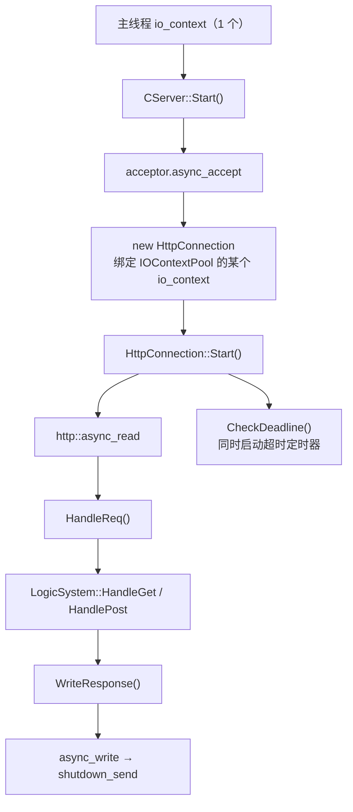

# 07 · GateServer（HTTP 网关）

| 项 | 值 |
| --- | --- |
| 源码 | `server/services/GateServer/` |
| 产物 | `bin/GateServer/` |
| 监听 | HTTP `0.0.0.0:8080`（端口取自 `[GateServer].Port`） |
| 依赖 | Boost.Beast / Boost.Asio、jsoncpp、gRPC、hiredis、mysql-connector-cpp、libsodium |
| 角色 | 面向客户端的唯一 HTTP 入口；不保存会话状态 |

## 7.1 模块构成

| 文件 | 职责 |
| --- | --- |
| `src/GateServer.cpp` | 入口：初始化配置、注册信号处理、启动 `CServer` |
| `include/CServer.h` / `src/CServer.cpp` | acceptor 骨架，从 `IOContextPool` 取 `io_context` 创建连接 |
| `include/HttpConnection.h` / `src/HttpConnection.cpp` | 单连接生命周期：异步读 → 路由 → 写回；URL 编解码；超时关闭 |
| `include/LogicSystem.h` / `src/LogicSystem.cpp` | URL → handler 注册表与四个业务 handler |
| `include/ConfigMgr.h` | ini 配置单例 |
| `include/IOContextPool.h` | io_context 线程池（CPU 核心数） |
| `include/RedisMgr.h` | Redis 连接池封装 |
| `include/MysqlMgr.h` / `MysqlDao.h` | MySQL 数据访问（X DevAPI） |
| `include/StatusGrpcClient.h` | 调 StatusServer 的 gRPC 客户端（池 5） |
| `include/VerifyGrpcClient.h` | 调 VerifyServer 的 gRPC 客户端（池 5） |
| `include/PasswordHash.h` / `src/PasswordHash.cpp` | libsodium Argon2id 哈希与校验 |

## 7.2 请求处理链路



| 环节 | 实现要点 |
| --- | --- |
| 连接分配 | `CServer` 用主 `io_context` 做 acceptor，实际连接的读写跑在 `IOContextPool` 的线程上 |
| 路由 | GET 走 `PreParseGetParam()` 剥离查询串后按纯路径匹配；POST 直接用 `_request.target()` |
| 404 | handler 未命中 → `http::status::not_found` + `text/plain` |
| 响应头 | `version` 跟随请求，`keep_alive(false)`（每请求一连接），`Server: GateServer` |
| 超时 | `deadline_` 定时器，响应写完 `cancel()`；超时未响应则 `socket.close()` |
| 关闭 | 信号处理捕获 `SIGINT` / `SIGTERM` → `ioc.stop()` |

## 7.3 URL 路由表

| 方法 | 路径 | 处理逻辑 |
| --- | --- | --- |
| GET | `/get_test` | 连通性测试，回显查询参数 |
| POST | `/get_verifycode` | 转 VerifyServer |
| POST | `/user_register` | 校验验证码 + 写库 |
| POST | `/reset_pwd` | 校验验证码 + 改密 |
| POST | `/user_login` | 校验密码 + 向 StatusServer 申请 ChatServer |

注册在 `LogicSystem` 构造函数中，用 `RegGet` / `RegPost` 把 `std::function` 存入
`std::map<std::string, HttpHandler>`。

## 7.4 各接口实现细节

### `/get_verifycode`

1. 解析 body JSON，缺 `email` → `1001`；
2. `VerifyGrpcClient::GetVerifyCode(email)`（gRPC 池取 Stub，失败返回 `1002`）；
3. 回 `{"error", "email"}`。

### `/user_register`

1. 解析 JSON，缺任一字段 → `1001`；
2. `passwd != confirm` → `1006`；
3. `RedisMgr::Get("code_" + email)`，取不到 → `1003`；
4. 与请求中 `verifycode` 比对，不等 → `1004`；
5. `MysqlMgr::RegUser(name, email, pwd)` → 内部调用存储过程 `reg_user`，
   返回 `0` / `-1` → `1005`；
6. 成功 → `{"error":0, "uid", "email", "user", "verifycode"}`。

> 注册成功后**不删除** `code_<email>`，验证码在 600s TTL 到期前仍可重复使用。

### `/reset_pwd`

1. 解析 JSON → `1001`；
2. 验证码存在性 → `1003`；比对 → `1004`；
3. `MysqlMgr::CheckEmail(name, email)` → `1007`；
4. `MysqlMgr::UpdatePwd(name, pwd)` → 失败 `1008`；
5. 成功 → `{"error":0, "email", "user", "verifycode"}`。

### `/user_login`

1. 解析 JSON → `1001`；
2. `MysqlMgr::CheckPwd(email, pwd, userInfo)`：
   先按 email 取出存储的 Argon2id 哈希串，再用 `PasswordHash::Verify` 常量时间比对，
   失败 → `1009`；
3. `StatusGrpcClient::GetChatServer(uid)` → 失败 `1002`；
4. 成功 → `{"error":0, "uid", "token", "host", "port"}`，客户端据此建立 TCP 长连接。

## 7.5 口令哈希（`PasswordHash`）

```cpp
static std::string Hash(const std::string& plain);          // 生成 Argon2id 串
static bool        Verify(const std::string& plain,
                          const std::string& stored);       // 常量时间校验
```

| 参数 | 取值 | 说明 |
| --- | --- | --- |
| 算法 | Argon2id | libsodium `crypto_pwhash_str` |
| `opslimit` | `crypto_pwhash_OPSLIMIT_MODERATE` | 时间开销 |
| `memlimit` | `crypto_pwhash_MEMLIMIT_MODERATE` | 内存开销 |
| 输出 | `crypto_pwhash_STRBYTES`（约 98 字节可见字符） | 自带随机 salt，存 `user.pwd` 的 `varchar(255)` |

`sodium_init()` 用 `std::once_flag` 保证只初始化一次，且不依赖静态初始化顺序。
**DAO 层接收明文并负责哈希**，因此调用方无需感知哈希细节，也不会出现明文落库。

> 历史数据已在改造时统一重算为 Argon2id，库中不存在旧格式，因此没有兼容分支。

## 7.6 连接池

| 池 | 容量 | 对象 |
| --- | --- | --- |
| `IOContextPool` | `hardware_concurrency()` | `io_context` + `work_guard` |
| `RPConPool`（Verify） | 5 | `VerifyService::Stub` |
| `StatusConPool`（Status） | 5 | `StatusService::Stub` |
| `RedisConPool` | 5 | `redisContext` |

所有池的关闭语义一致：置 `b_stop_` 后 `notify_all()`，
等待中的线程醒来后返回空指针（或 false），调用方按失败处理。

## 7.7 性能与风险

| 事项 | 说明 |
| --- | --- |
| handler 同步阻塞 | 业务 handler 直接在 IO 线程执行，内含 gRPC 与 MySQL 访问，会阻塞该线程。高并发下吞吐受限于 `IOContextPool` 线程数 |
| 无 TLS | HTTP 明文；密码仅经客户端可逆 XOR 变形 |
| 无连接限流 | 未限制并发连接数与请求速率 |
| 验证码不失效 | 注册/改密成功后未删除 `code_<email>` |

## 7.8 扩展方式

新增一个 HTTP 接口：

1. 在 `LogicSystem::LogicSystem()` 中用 `RegGet` / `RegPost` 注册路径与 lambda；
2. handler 签名 `bool(std::shared_ptr<HttpConnection>)`，
   通过 `beast::buffers_to_string(connection->_request.body().data())` 取 body，
   用 `connection->_response` 写响应；
3. 返回值当前未被使用（统一返回 `true`），路由层只看"是否命中"。
