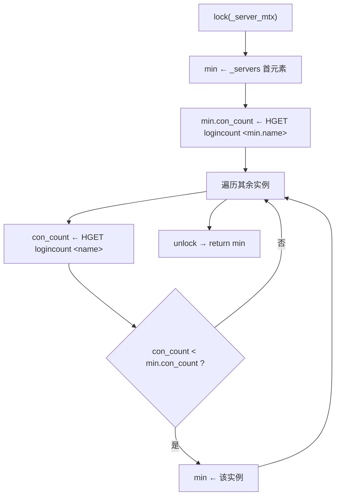
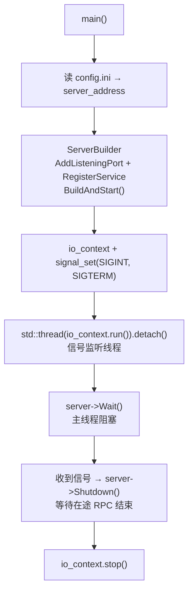

# 08 · StatusServer（状态路由与令牌服务）

| 项 | 值 |
| --- | --- |
| 源码 | `server/services/StatusServer/` |
| 产物 | `bin/StatusServer/` |
| 监听 | gRPC `[StatusServer].Host:Port`，默认 `127.0.0.1:50052` |
| 依赖 | gRPC / protobuf、Boost.Asio（信号）、Boost.Uuid、hiredis、mysql-connector-cpp |
| 角色 | 登录时签发 token；按最小连接数为客户端挑选 ChatServer 实例 |

## 8.1 模块构成

| 文件 | 职责 |
| --- | --- |
| `src/StatusServer.cpp` | 入口：构建 gRPC Server，启动信号处理线程，`Wait()` 阻塞 |
| `src/StatusServiceImpl.cpp` | `GetChatServer` 与 `Login` 两个 RPC 的实现 |
| `src/ChatGrpcClient.cpp` | **当前未被调用**的 ChatServer gRPC 客户端（见 8.6） |
| `src/ConfigMgr.cpp` / `IOContextPool.cpp` / `RedisMgr.cpp` / `MysqlMgr.cpp` / `MysqlDao.cpp` | 公共基础设施 |

## 8.2 启动时加载的实例表

`StatusServiceImpl` 构造时读取 `[chatservers].Name`（逗号分隔），逐个读 `[<name>]` 段的
`Name` / `Host` / `Port`，填入 `std::map<std::string, ChatServer> _servers`：

| 配置来源 | `_servers` 条目 |
| --- | --- |
| `[chatserver1]` | `{name=chatserver1, host=127.0.0.1, port=8090}` |
| `[chatserver2]` | `{name=chatserver2, host=127.0.0.1, port=8091}` |

这里的 `Port` 是**客户端连接的 TCP 端口**，会被原样返回给客户端，不要和 ChatServer
`[PeerServer]` 里的 RPC 端口混淆。

## 8.3 `GetChatServer`

```cpp
Status GetChatServer(ServerContext*, const GetChatServerReq* req, GetChatServerRsp* reply);
```

流程：

1. `getChatServer()` 选出目标实例；
2. 填 `host` / `port` / `error = Success`；
3. `generate_unique_string()` 生成 UUID 作为 token；
4. `insertToken(uid, token)` → `Redis SET utoken_<uid> <token>`；
5. 返回 `Status::OK`。

### 最小连接数选路（`getChatServer`）



`HGET` 取不到值时把 `con_count` 置为 `INT_MAX`，表示该实例排在最后。

| 特性 | 说明 |
| --- | --- |
| 数据源 | Redis Hash `logincount`，field = 实例名，value = 在线连接数 |
| 未登记计数 | 视为 `INT_MAX`，即排在最后——新启动但尚未写入计数的实例不会被优先选中 |
| 并发保护 | `_server_mtx` 保护 `_servers`；计数本身由 Redis 的 `HINCRBY` 保证原子 |
| 复杂度 | O(n)，n 为实例数；每次 `HGET` 一次 Redis 往返 |

> ChatServer 启动时执行 `HSET logincount <name> 0`，因此正常启动的实例不会落到 `INT_MAX` 分支。

## 8.4 `Login`（令牌校验）

```cpp
Status Login(ServerContext*, const LoginReq* req, LoginRsp* reply);
```

| 分支 | 返回 `error` |
| --- | --- |
| `Redis GET utoken_<uid>` 失败 | `UidInvalid(1011)` |
| token 不相等 | `TokenInvalid(1010)` |
| 校验通过 | `Success(0)`，回填 `uid` / `token` |

**当前无人调用**：ChatServer 登录时直接读 `utoken_<uid>` 自行比对，没有走这个 RPC。
两种校验逻辑等价，但存在重复实现。收敛方案见 `11-known-limitations.md`。

## 8.5 生命周期



## 8.6 `ChatGrpcClient` 的现状

`StatusServer` 目录下保留了 `ChatGrpcClient`（含 `ChatConPool`），但：

- 全仓库除自身实现外**没有任何调用点**；
- `NotifyAddFriend` 只有一个空壳实现（构造 `AddFriendRsp` 后直接返回）；
- 其构造函数用 `cfg[word]["Port"]` 建池，而 `StatusServer/config.ini` 中该字段是 **TCP 端口（8090）**，
  并非 ChatServer 的 RPC 端口（50055）。

结论：这是从 ChatServer 复制过来的**死代码**，且若未来被实例化会连到错误端口。
建议删除，或在需要"服务端主动通知 ChatServer"的场景下修正端口语义后再启用。

## 8.7 扩展与变更

| 需求 | 改动点 |
| --- | --- |
| 新增实例 | `config.ini` 的 `[chatservers].Name` 追加名字，并补 `[<name>]` 段（TCP 端口） |
| 换调度策略（如加权、一致性哈希、按地域） | 改写 `getChatServer()`；`_servers` 中已有 `con_count` 字段可承载权重 |
| 让 token 带有效期 | `insertToken` 改用 `SETEX`（需同步 ChatServer 的读取与连接清理逻辑，否则计数会漂移） |
| 增加实例健康检查 | 当前无探活；可在 `getChatServer()` 中跳过 `HGET` 长时间未更新的实例 |
