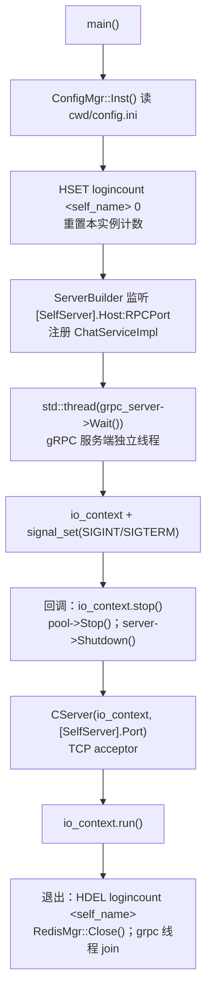
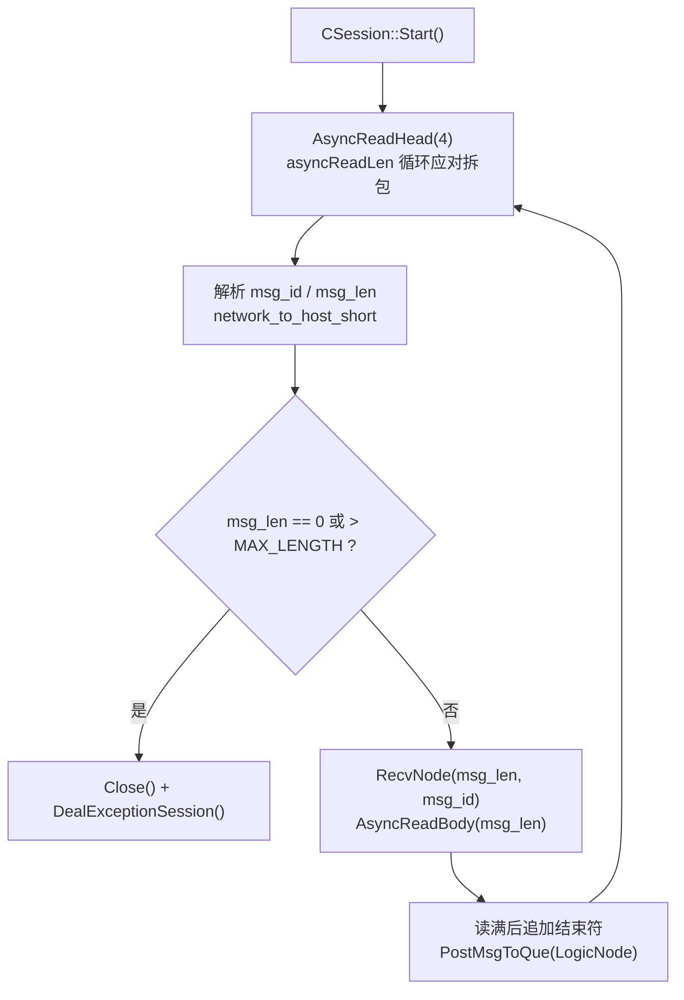
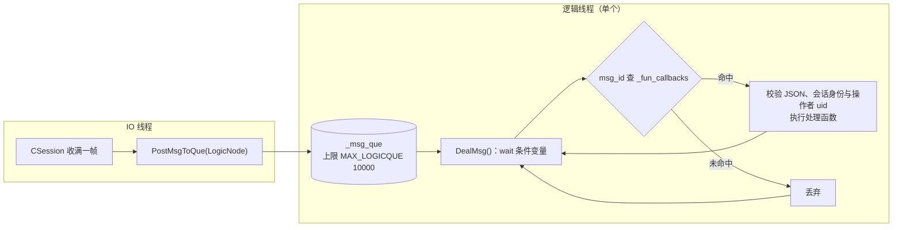
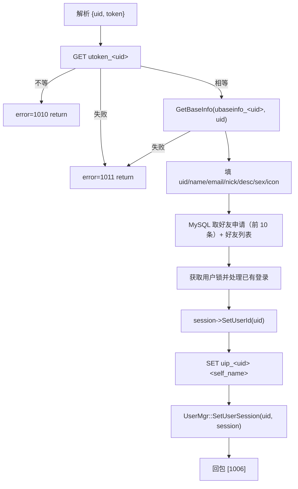
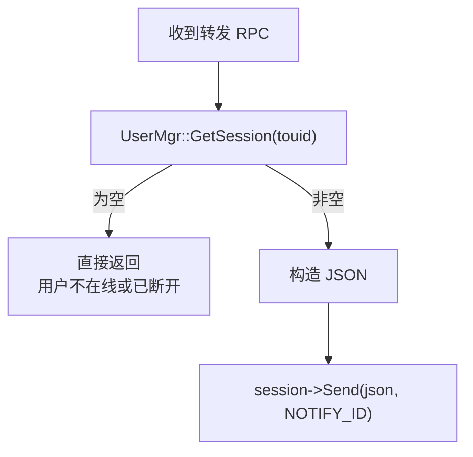

# 09 · ChatServer（长连接消息服务，多实例）

| 项 | 值 |
| --- | --- |
| 源码 | `server/services/ChatServer/` |
| 产物 | `bin/<实例名>/`，每份 `config/*.ini` 一个实例 |
| 监听 | TCP `[SelfServer].Port`（客户端，8090 / 8091）；gRPC `[SelfServer].RPCPort`（服务间，50055 / 50056） |
| 依赖 | Boost.Asio、gRPC / protobuf、jsoncpp、hiredis、mysql-connector-cpp |
| 角色 | 承载客户端长连接；处理登录、搜索、好友申请/认证、文本消息；跨实例转发 |

## 9.1 模块构成

| 文件 | 职责 |
| --- | --- |
| `src/ChatServer.cpp` | 入口：初始化计数、启动 gRPC 服务端线程、启动 TCP `CServer` |
| `src/CServer.cpp` | TCP acceptor；`_sessions` 表；`ClearSession` 负责断连清理 |
| `src/CSession.cpp` | 单会话：异步读头/体、发送队列、帧编解码 |
| `src/MsgNode.cpp` | `RecvNode` / `SendNode` 消息节点 |
| `src/LogicSystem.cpp` | 逻辑队列 + 单线程消费 + 消息处理函数注册表 |
| `src/UserMgr.cpp` | `uid → CSession` 映射（供本实例直投） |
| `src/ChatServiceImpl.cpp` | gRPC 服务端：接收其他实例的转发并投递给本地会话 |
| `src/ChatGrpcClient.cpp` | gRPC 客户端：向对端实例发起转发（Stub 池 5） |
| `src/StatusGrpcClient.cpp` | StatusServer 客户端（**当前未被调用**） |
| `src/IOContextPool.cpp` / `ConfigMgr.cpp` / `RedisMgr.cpp` / `MysqlMgr.cpp` / `MysqlDao.cpp` | 基础设施 |

## 9.2 启动流程



## 9.3 会话与帧处理

### 接收



### 发送

`CSession::Send()` 有两个重载（`std::string` 与 `char*`），逻辑一致：

```
检查长度，投递到 socket 所属 IO 线程
if _send_que.size() >= MAX_SENDQUE(1000): 关闭并清理连接
push SendNode(msgid)
if 队列此前为空: 立即 async_write（否则由 HandleWrite 链式续写）
```

`HandleWrite` 由 IO 线程回调：`pop()` 已发送节点，若队列非空继续写下一个。
`shared_from_this()` 保证回调期间会话对象存活。
每个 io_context 只有一个工作线程，收发与关闭在该线程串行执行，三平台行为一致。
发送失败时终止续写，并在回调完成后释放发送缓冲区。

### 断连清理（`CServer::ClearSession`）

```
lock(_mutex)
find session_id → 未找到直接 return
erase
↓
uid = session->GetUserId()
if uid == 0: return                       # 未登录的连接不参与清理
UserMgr::RmvUserSession(uid, session_id)
```

`_user_uid == 0` 是"未登录"哨兵（真实 uid 从 1000 起）。
`DealExceptionSession` 与登录登记通过会话互斥锁排序，且只清理一次。
已认证会话取得 Redis 用户锁后，确认 `usession_<uid>` 仍属于自身，才删除会话键与位置键。
连接计数由定时器每 60 秒扫描后用 `HSET` 上报，登录和断连不直接增减计数。

## 9.4 逻辑层



| 特性 | 说明 |
| --- | --- |
| 单消费者 | TCP 业务处理串行执行；共享用户映射仍由互斥锁保护 |
| 优雅退出 | `_b_stop` 置位后先把队列剩余消息处理完再退出 |
| 未知 ID | 无注册 handler 时丢弃 |

注册的 handler：

| ID | 函数 | 说明 |
| --- | --- | --- |
| 1005 | `LoginHandler` | 校验 token、绑定会话、下发资料 |
| 1007 | `SearchInfo` | 按 uid / 用户名搜索 |
| 1009 | `AddFriendApply` | 好友申请 |
| 1013 | `AuthFriendApply` | 同意好友申请 |
| 1017 | `DealChatTextMsg` | 文本消息 |

出队后释放队列锁，数据库/RPC 不持有队列锁；单条请求异常会关闭对应连接，不终止逻辑线程。
各 handler 用 `Defer`（析构时执行 lambda）处理正常业务分支的回包。

## 9.5 登录（1005）



> 无法取得用户锁时返回失败；同一连接不能重复登录或切换 uid。资料回包不含密码哈希。

## 9.6 消息路由：本实例 vs 跨实例

三个需要投递给他人的 handler（1009 / 1013 / 1017）共用同一套判定：

```cpp
to_ip_key  = "uip_" + std::to_string(touid);
b_ip       = RedisMgr::Get(to_ip_key, to_ip_value);
if (!b_ip) return;                       // 目标不在线（或位置键已过期）→ 静默丢弃
if (to_ip_value == self_name) {
    session = UserMgr::GetInstance()->GetSession(touid);
    if (session) session->Send(json, NOTIFY_ID);   // 本实例直投
    return;
}
ChatGrpcClient::GetInstance()->NotifyXxx(to_ip_value, req);  // 跨实例 gRPC 转发
```

| 路径 | 开销 |
| --- | --- |
| 本实例直投 | 一次 `UserMgr` 查找 + 一次 `Send()`，无网络往返 |
| 跨实例 | 一次 gRPC 调用（Stub 池复用连接）→ 对端 `ChatServiceImpl` → `UserMgr` → `Send()` |

### `ChatServiceImpl`（gRPC 服务端）

三个方法结构相同：



`NotifyAuthFriend` 会调 `GetBaseInfo` 补全发起方资料（name / nick / icon / sex）。

### `ChatGrpcClient`（gRPC 客户端）

- 构造时读 `[PeerServer].Servers`，为**每个对端**建一个 `ChatConPool`（5 条 Stub）；
  对端地址取自 `[<对端名>].Host` 与 `[<对端名>].Port`（**对端的 RPCPort**）；
- 每个转发方法：查池 → `getConnection()` → 发起 RPC → `Defer` 归还 Stub；
  失败置 `RPCFailed(1002)`。

## 9.7 好友相关流程

### 申请（1009）

1. 解析 `{uid, applyname, bakname, touid}`；
2. `MysqlMgr::AddFriendApply(uid, touid)`（唯一键冲突时 `ON DUPLICATE KEY` 静默）；
3. 查 `uip_<touid>`；
4. 本实例 → 构造 1011 通知；跨实例 → `NotifyAddFriend`。

### 同意（1013）

1. 解析 `{fromuid, touid, back}`；
2. `AddFriend(uid, touid, back_name)` 开启事务并锁定对方向自己的好友申请，无申请则失败；
3. 同一事务内把申请状态置 1，再双向插入 `friend` 表（`INSERT IGNORE`）；
4. 回 1014（附对方资料）；
5. 通知对方 1015（本实例直投 / 跨实例 `NotifyAuthFriend`）。

> 写库失败回滚事务并返回错误，不发送成功通知。

## 9.8 文本消息（1017）

1. 解析 `{fromuid, touid, text_array:[{content, msgid}]}`；
2. 构造 1018 回执（`error` + 原样 `text_array`），由 `Defer` 保证回包；
3. 查 `uip_<touid>` → 本实例直投 1019 / 跨实例 `NotifyTextChatMsg`。

消息**不落库**，离线即丢弃。

## 9.9 多实例部署

详见 `02-build.md` §2.4。运行时要点：

- 同一份可执行文件，靠各自目录下的 `config.ini` 区分身份；
- `[SelfServer].Name` 必须与 `StatusServer` 登记的名字**完全一致**，否则 `uip_<uid>` 与
  `logincount` 的 field 对不上，路由会全部走跨实例路径；
- `[PeerServer]` 只需列**对端**，不必列自己；
- 新增实例后，**已存在实例的 ini 也要更新**（把新实例加进自己的 `PeerServer` 与对端段），
  否则跨实例转发会找不到连接池而静默失败。

## 9.10 并发与线程安全

| 结构 | 保护方式 |
| --- | --- |
| `_sessions`（CServer） | `std::mutex _mutex` |
| `_send_que`（CSession） | 仅由 socket 所属 IO 线程访问 |
| `_msg_que`（LogicSystem） | `std::mutex` + `condition_variable` |
| `_pools`（ChatGrpcClient） | 构造期写、运行期只读 |
| `UserMgr` | 逻辑线程、IO 线程与 gRPC 线程访问，映射由互斥锁保护 |

> 单次映射访问已有互斥保护；多个操作的业务一致性仍需通过会话标识与登录锁保证。

## 9.11 已知问题

- `StatusGrpcClient` 已链接但未调用；若启用可改为由 StatusServer 统一校验 token。
- `GetBaseInfo` 在 `LogicSystem`、`ChatServiceImpl`、`ChatGrpcClient` 三处重复。
- 断连时检查 session 标识后清理位置键；Redis 不可用或锁获取失败时仍可能残留。
- 心跳阈值 20 秒、扫描周期 60 秒，半开连接最多接近 80 秒才回收，计数更新存在延迟。
- 消息与好友操作均无重试、无补偿；跨实例 RPC 失败即丢弃。
