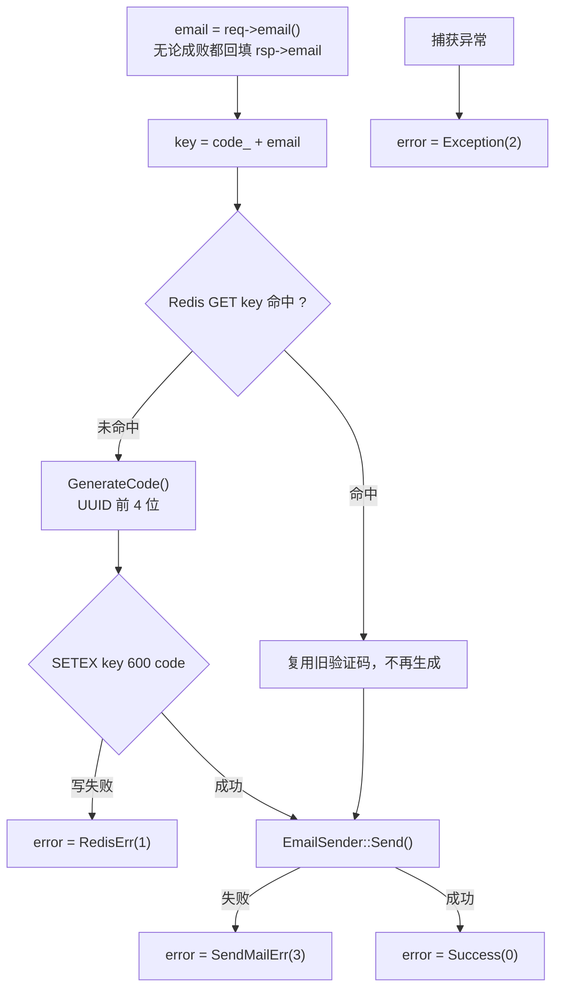
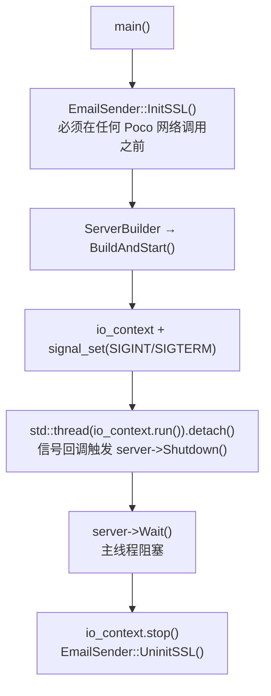

# 10 · VerifyServer（验证码服务）

| 项 | 值 |
| --- | --- |
| 源码 | `server/services/VerifyServer/` |
| 产物 | `bin/VerifyServer/` |
| 监听 | gRPC `[VerifyServer].Host:Port`，默认 `0.0.0.0:50051` |
| 对外 | SMTP over SSL（默认 465） |
| 依赖 | gRPC / protobuf、hiredis、Boost.Uuid、Poco Net / NetSSL |
| 角色 | 生成验证码 → 写 Redis → 发邮件 |

> 本服务由 Node.js 实现改写为 C++，行为与原实现保持一致：
> 复用未过期验证码、UUID 前 4 位、`SETEX 600s`、错误码 0/1/2/3 不变。

## 10.1 模块构成

| 文件 | 职责 |
| --- | --- |
| `src/VerifyServer.cpp` | 入口：初始化 OpenSSL、启动 gRPC、注册信号处理、退出时反初始化 |
| `src/VerifyServiceImpl.cpp` | RPC 实现：查/生成验证码、写 Redis、调用发信 |
| `src/EmailSender.cpp` | SMTP 客户端封装（Poco），含 CA 路径解析 |
| `src/RedisMgr.cpp` | Redis 连接池封装（池 5） |
| `src/ConfigMgr.cpp` | ini 配置单例 |
| `include/const.h` | `VerifyCodes`、`CODE_PREFIX`、`CODE_EXPIRE_SECONDS`、`CODE_LENGTH` |

## 10.2 `GetVerifyCode` 流程

```cpp
grpc::Status VerifyServiceImpl::GetVerifyCode(grpc::ServerContext*,
                                              const GetVerifyReq* req,
                                              GetVerifyRsp* rsp);
```



| 常量 | 值 | 位置 |
| --- | --- | --- |
| `CODE_PREFIX` | `"code_"` | `const.h` |
| `CODE_EXPIRE_SECONDS` | `600` | `const.h` |
| `CODE_LENGTH` | `4` | `const.h` |

> 提示文案写的是"三分钟内完成注册"，而实际 TTL 是 600 秒（10 分钟），两者不一致。

### 验证码生成

```cpp
thread_local boost::uuids::random_generator generator;
return boost::uuids::to_string(generator()).substr(0, 4);
```

- `random_generator` **非线程安全**，用 `thread_local` 给每个调用线程一份实例；
- UUID 形如 `xxxxxxxx-xxxx-...`，取前 4 位必为十六进制字符（`0-9a-f`）。

### 复用语义

有效期内重复请求会复用同一验证码，但**仍会再发一次邮件**。
好处是用户重复点击不会收到两个不同的码；代价是同一邮箱可在 10 分钟内收到多封相同内容的邮件。

## 10.3 SMTP 发信（`EmailSender`）

### SSL 初始化

```cpp
Poco::Net::initializeSSL();
SSLManager::instance().initializeClient(nullptr,
    new AcceptCertificateHandler(false), nullptr);   // 校验失败由 handler 决定是否接受
```

配合 `Context::VERIFY_RELAXED`：会校验证书链与主机名，但校验出问题时交给 handler 处理，
而不是直接中断连接。

### 连接与发送

```cpp
Context::Ptr ctx = new Context(Context::TLS_CLIENT_USE, ca_location,
                               Context::VERIFY_RELAXED, 9,
                               ca_location.empty(),          // loadDefaultCAs
                               "ALL:!ADH:!LOW:!EXP:!MD5:@STRENGTH");
SocketAddress addr(host, port);
SecureStreamSocket socket(addr, host, ctx);                  // 465：连接即 TLS
SMTPClientSession session(socket);
session.login(host);                                          // EHLO
session.login(SMTPClientSession::AUTH_LOGIN, user, pass);     // 授权码认证
```

| 关键点 | 说明 |
| --- | --- |
| 465 是隐式 SSL | 必须在**建立连接时**完成 TLS 握手，因此用 `SecureStreamSocket(addr, host, ctx)` 建连再交给 `SMTPClientSession`。`SecureSMTPClientSession` 只做 STARTTLS（587），不适用 |
| `hostName` 参数 | 传给 `SecureStreamSocket` 的第二个参数用于证书主机名校验 |
| 中文编码 | 主题用 `MailMessage::encodeWord(subject, "UTF-8")`（RFC 2047）；正文 `text/plain; charset=UTF-8`。缺任一项客户端会显示乱码 |
| 发件人 | `From` 留空时取 `User` |
| 收尾 | `session.close()` 发送 QUIT 并关闭连接 |

### CA 路径三级回退（`ResolveCAPath`）

按下面顺序探测，第一个命中的生效：

| 顺序 | 条件 | 结果 |
| --- | --- | --- |
| 1 | `[Email].CA` 已配置且文件存在 | 使用该路径（私有 CA 场景） |
| 2 | 已配置但文件不存在 | 打印告警后继续探测，保证同一份 ini 在三平台都能启动 |
| 3 | 未配置 | 依次探测 `/etc/ssl/cert.pem`、`/etc/ssl/certs/ca-certificates.crt`、`/etc/pki/tls/certs/ca-bundle.crt` |
| 4 | 仍未命中 | `loadDefaultCAs = true`，用 OpenSSL 默认证书目录（Windows 通常走到这步） |

Windows 没有系统级 PEM 证书库，`CA` 保持留空即可。证书校验失败会**直接导致发信失败**。

## 10.4 生命周期



## 10.5 配置项

见 `05-configuration.md` §5.5。要点复述：

- `[Email].Pass` 是邮箱**授权码 / 应用专用密码**，不是登录密码；
- 换用 587（STARTTLS）需要同时改配置与代码（`SecureSMTPClientSession`）；
- `[VerifyServer].Host` 填 `0.0.0.0` 允许非本机访问。

## 10.6 与其他服务的边界

| 方向 | 内容 |
| --- | --- |
| 入 | GateServer 调用 `GetVerifyCode`（Stub 池 5） |
| 出 | Redis（`SETEX`）、SMTP |
| 不使用 | **不访问 MySQL**（因此未链接 mysql-connector-cpp，也不在顶层 zstd/lz4 补链接列表里） |

## 10.7 已知问题

| 问题 | 说明 |
| --- | --- |
| 提示文案与 TTL 不一致 | "三分钟" vs 600 秒 |
| 验证码不失效 | 注册/改密成功后未 `DEL code_<email>`，10 分钟内可重复使用 |
| 无发送频率限制 | 同一邮箱可被无限次触发发信，存在被滥用于邮件轰炸的风险 |
| 邮件内容硬编码 | 文案写死在 `VerifyServiceImpl` 中，未做模板化或多语言 |
| 失败不重试 | SMTP 临时性失败（网络抖动）直接返回 `SendMailErr(3)` |
